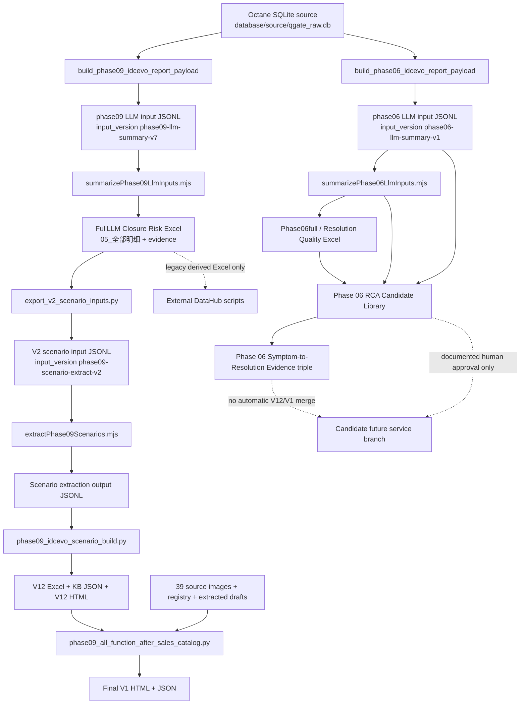

# Phase 09 Ticket To After-Sales Decision Tree

Use this skill to operate the governed IDCEVO Phase 09 lineage from raw Octane
ticket evidence to the final after-sales catalog, plus its separate,
review-gated Phase 06 resolution-evidence lane.

For the merged Open Shift/Phase 09 **current-state** analysis, including the
combined catalog, phase/date filters and publication to an existing HTML path,
use [Shift/Tolerate Current Analysis](../shift-tolerate-current-analysis/SKILL.md).
That focused skill contains the local database-first artifact workflow,
incremental model-cache reuse, the producer map and publication checks.
Octane synchronization is maintained separately and is not part of that skill;
do not route that task through the historical 18,000-ticket pipeline below.

```text
IDCEVO_Phase09_Field_Escape_Scenario_Library_V12_Symptom_to_Solution_Trees.xlsx
IDCEVO_Phase09_Field_Escape_Scenario_Library_V12_Symptom_to_Solution_Trees_Decision_Tree_Knowledge_Base.json
IDCEVO_Phase09_Field_Escape_Scenario_Library_V12_Symptom_to_Solution_Trees_Decision_Tree_Catalog.html
IDCEVO_Phase09_All_Function_AfterSales_Decision_Tree_Catalog_V1.html
IDCEVO_Phase09_All_Function_AfterSales_Decision_Tree_Catalog_V1.json
```

The final V1 catalog is **not** the source of truth. It is a browser view
derived from a validated V12 Excel/KB pair plus the registered after-sales
source-tree assets.

Read [lineage and release contract](./references/lineage-and-release-contract.md)
before running a rebuild. Read [DataHub boundary](./references/datahub-boundary.md)
when the request mentions `C:\Users\q446328\Desktop\datahub`.
Read [Phase 06 resolution-evidence lane](./references/phase06-resolution-evidence-lane.md)
before auditing or rebuilding Phase 06 artifacts.

## When To Use

Use this skill when a user asks to:

- Trace how Phase 09 Tickets became LLM summaries, V12 scenarios, or the V1
  after-sales catalog.
- Refresh/rebuild `FullLLM`, `Field Escape Scenario Library V12`, or final V1.
- Publish a candidate V12/V1 release from an approved snapshot.
- Audit or rebuild Phase 06 resolution evidence, its RCA Candidate Library, or
  its symptom-to-resolution evidence-tree triple.
- Reconcile DataHub's legacy audit scripts with the current Vizion Lab pipeline.
- Diagnose a mismatch between raw Ticket counts, LLM summaries, V12 scenarios,
  Phase 06 resolution evidence, V1 catalog data, or after-sales source images.

Do **not** use this skill for QGate KPI reports or a generic Excel export
unrelated to either governed IDCEVO Phase 09 or Phase 06 artifact chain.

## Authority And Boundaries

1. **Raw source of truth**: the Octane SQLite source selected by
   `VIZION_FULL_PICTURE_SOURCE_DB_PATH`, otherwise
   `database/source/qgate_raw.db`. It must contain `octane_defects` and
   `octane_defect_history_events`.
2. **LLM summaries are derived evidence**: they must match the current bounded
  input by Ticket ID, `input_fingerprint`, and `input_version`. Phase 09 and
  Phase 06 caches use independent versions and must never be interchanged.
3. **V12 is a historical navigation model**: its Ticket-recorded recovery text
   is not an approved repair or verified root cause.
4. **After-sales source images remain authoritative source assets**: data-derived
   branches do not rewrite image rules automatically.
5. **Phase 06 is an evidence lane, not an automatic promotion lane**: its
  repair-plan/decision text is recorded Ticket evidence. P1/P2 candidates and
  Phase 06 navigation trees remain `human_review_required` until external
  technical approval documents a rule.
6. **DataHub is not an upstream Ticket or LLM system**. It owns a local tool
  catalog and legacy Excel post-processing only; do not describe it as the
  Octane ingestion, LLM, Phase 06 producer, V12, or V1 producer.
7. Never print or request API keys, cookies, passwords, or raw protected Ticket
   content in chat. Let local runners read their configured environment.
8. **Current status requires per-ticket source verification**, not merely a
  populated SQLite file or `max(fetched_at)`. Check metadata, comments, complete
  history, refresh provenance and canonical/cache/raw-JSON consistency for the
  exact approved IDs. A zero-comment row without fetch provenance is unknown,
  not a successful empty response. Default nightly teams may not cover the
  approved cohort's finder teams.
9. **Historical process evidence is not current pending postponement**. Separate
  historical Shift/Tolerate, current postponement, repair/testing/verification,
  and release integration/delivery. Resolve dates, retractions, negations and
  related-ticket attribution; Phase 05/08 or a target version alone proves
  neither verified repair nor delivery. A lexical process/version match is a
  review candidate, not a confirmed current decision.
10. **Verify evidence at the model transport boundary**. Default chat compaction
   can keep only the last 6,000 characters of a message. Structured analysis
   must preserve its explicitly bounded JSON with an explicit message budget,
   reject over-budget input, and isolate its analyst system instructions.
   A matching pre-transport fingerprint alone cannot prove all evidence reached
   the model. Old five-field/v7 summaries are not current-state assessments.

## Pick The Correct Run Mode

Before writing any artifact, record in the task output:

- Exact input paths and snapshot date.
- Requested output stem/version.
- Whether an existing artifact may be overwritten.
- Whether this is a **full rebuild**, **V12 triple refresh**, or **V1 refresh
  from an approved V12 snapshot**.

### A. Audit Lineage Only

Use read-only inspection. Do not invoke LLM runners, Excel writers, or legacy
DataHub scripts. Report the verified source paths, row counts, sheet names,
schema versions, and missing artifacts.

### B. Refresh V1 From A Validated V12 Snapshot

Use this for a display/catalog change when V12 scenario data is already
approved. This is the usual path for final V1 HTML changes.

### C. Rebuild V12 From Cached Scenario Extraction

Use this when normalization, Service Function mapping, V12 tree generation, or
V12 rendering changed but `v2_scenario_18000_outputs.jsonl` is trustworthy.
Do not call the scenario-extraction LLM again.

### D. Full Rebuild From Raw Tickets

Use this only when raw Ticket input, summary prompt/version, scenario extractor,
or stale/missing caches require it. This path performs LLM work and requires
configured local credentials.

### E. Audit Or Rebuild Phase 06 Resolution Evidence

Use this to assess concluded/resolved Ticket evidence, the Phase 06 RCA Candidate
Library, or the separate symptom-to-resolution evidence triple. It has its own
`phase06-llm-summary-v1` cache and does not regenerate, overwrite, or directly
extend Phase 09 V12/V1 artifacts.

## Canonical Lineage



## Procedure

### 1. Preflight Source And Release State

Check before a write-capable action:

```powershell
Test-Path database\source\qgate_raw.db
Test-Path exports\idcevo_phase09\decision_tree_sources\tree_registry.json
Test-Path exports\idcevo_phase09\decision_tree_sources\lossless_webp\manifest.json
```

For any candidate V12 pair, validate all of the following:

- V12 Excel `01_Scenario_Library` exists and has nonblank scenarios.
- The matching KB JSON has one `decision_trees` entry per Service Function.
- Excel scenario count equals `sum(decision_trees[].scenario_count)`.
- Ticket mapping count is consistent with Scenario ticket counts.
- The exact Excel and KB are from the same snapshot/stem.

Do not silently use the reduced/inconsistent V12 snapshot under
`exports/idcevo_phase09` when a workflow needs the validated full backup. The
full V12 backup currently used for source-tree overlay work lives under:

```text
C:\Users\q446328\Downloads\defectdecisiontree\
```

### 2. Raw Ticket To FullLLM (Only For A Full Rebuild)

Use the following owning abstractions rather than editing Excel cells:

1. `backend.analytics.phase09_idcevo_report.build_phase09_idcevo_report_payload`
   reads the Octane SQLite source and reconstructs ticket evidence, closure facts,
   risks, history, comments, and evidence indexes.
2. `backend.analytics.phase09_idcevo_llm_summary.export_phase09_llm_summary_inputs`
   creates bounded v7 JSONL inputs with a fingerprint.
3. `scripts/summarizePhase09LlmInputs.mjs` creates resumable LLM summary JSONL.
4. `backend.analytics.phase09_idcevo_excel_report.generate_phase09_idcevo_excel_report`
   generates the FullLLM workbook and applies only matching fingerprints.

Example Windows commands are deliberately split into candidate files:

```powershell
$env:PYTHONIOENCODING = "utf-8"

.venv\Scripts\python.exe -m backend.analytics.phase09_idcevo_llm_summary `
  --db-path "database\source\qgate_raw.db" `
  --all-tickets `
  --output "exports\idcevo_phase09\llm\phase09_candidate_inputs_v7.jsonl"

node scripts\summarizePhase09LlmInputs.mjs `
  --input "exports\idcevo_phase09\llm\phase09_candidate_inputs_v7.jsonl" `
  --output "exports\idcevo_phase09\llm\phase09_candidate_summaries_v7.jsonl" `
  --error-output "exports\idcevo_phase09\llm\phase09_candidate_summaries_v7.errors.jsonl" `
  --model deepseek-v4-pro `
  --concurrency 5 `
  --max-retries 3
```

For a long run, preserve resumability: the runner skips a Ticket only when the
cached output fingerprint matches. Use bounded batches (`--limit 500`) when the
host has memory pressure. Do not hand-backfill Excel cells; regenerate the
workbook through `generate_phase09_idcevo_excel_report`.

### 2A. Phase 06 Resolution-Evidence Lane

Use the native Vizion Lab Phase 06 implementation, not DataHub. It reads all
Phase 06-concluded Tickets and produces the independent
`phase06-llm-summary-v1` cache, Phase 06 workbook, RCA Candidate Library, and
symptom-to-resolution evidence triple.

The terminal evidence comes only from recorded `修复计划证据` or `决策证据`.
It is never a verified repair instruction. `无修复证据` blocks P1 priority and
must remain visible for human review. Follow the exact commands, required fields,
candidate naming, and promotion gate in
[Phase 06 resolution-evidence lane](./references/phase06-resolution-evidence-lane.md).

### 2B. Current Shift/Tolerate Source Repair And Reanalysis

Use the [complete current-analysis workflow](../shift-tolerate-current-analysis/SKILL.md)
for its code map, staged commands, filters, locked-file handling and exact-path
publication checks.

For an approved merged Open Shift/Phase 09 cohort, follow the exact-ID commands
and gates in [Current Source Evidence Contract](./references/lineage-and-release-contract.md#current-source-evidence-contract).
Do not rebuild a supposedly current release from the old workbook summaries.

The owning entry points are:

- `scripts/rebuild_shift_current_evidence.py --from-database`: direct database
  project/date selection, frozen local evidence, fingerprinted model inputs and
  native source/triple generation, without old Excel/KB or repair artifacts.
- `backend/analytics/shift_database_workflow.py`: database-snapshot scope,
  integrity checks and reuse of the existing analysis/native writers. Offline
  rows are not counted as verified current online evidence.
- `scripts/refresh_shift_tolerate_evidence.py`: scoped backup and resumable
  metadata/comments/full-history refresh, with explicit unavailable IDs.
- `scripts/rebuild_shift_current_evidence.py --knowledge-base`: repaired-KB source preflight,
  `shift-current-evidence-v2` inputs, summary validation and synchronized candidate.
- `scripts/summarizeOpenTicketPostponementInputs.mjs`: cited current-state model
  output with a complete bounded transport and version/fingerprint cache checks.

Keep inaccessible/unreturned tickets in historical scope, marked
`unavailable_preserved`, never as current empty evidence. Unsupported model
status claims become explicit unknown/review states with audit warnings; never
invent citations. Diagnostic presentation redaction must not modify raw evidence.
Unavailable exceptions require an enumerated `--expected-unavailable-ids`
allowlist; no generic permission to accept arbitrary collection omissions.

### 3. FullLLM To V2 Scenario Extraction

The V2 scenario input exporter consumes:

- FullLLM `05_全部明细` for structured Ticket facts and LLM summary.
- A separately extracted evidence workbook `06_证据原文` for bounded Ticket
  descriptions and comments.

Use [exporter](../../../exports/idcevo_phase09/llm/export_v2_scenario_inputs.py)
and the scenario runner:

```powershell
# Set module constants in one candidate process when source file names differ.
.venv\Scripts\python.exe -c @'
from pathlib import Path
import exports.idcevo_phase09.llm.export_v2_scenario_inputs as exporter

exporter.FULL_LLM_EXCEL = Path(r"<validated FullLLM Complete.xlsx>")
exporter.EVIDENCE_EXCEL = Path(r"<validated evidence workbook.xlsx>")
exporter.OUTPUT_PATH = Path(r"exports\idcevo_phase09\llm\v2_candidate_inputs.jsonl")
raise SystemExit(exporter.main())
'@

node scripts\extractPhase09Scenarios.mjs `
  --input "exports\idcevo_phase09\llm\v2_candidate_inputs.jsonl" `
  --output "exports\idcevo_phase09\llm\v2_candidate_outputs.jsonl" `
  --error-output "exports\idcevo_phase09\llm\v2_candidate_outputs.errors.jsonl" `
  --model deepseek-v4-pro `
  --concurrency 20 `
  --max-retries 3

.venv\Scripts\python.exe scripts\dedup_jsonl.py `
  "exports\idcevo_phase09\llm\v2_candidate_outputs.jsonl"
```

The scenario extractor must keep its `phase09-scenario-extract-v2` input
fingerprint and output schema. It distinguishes customer-facing scenarios from
excluded tickets (`spec_confirmed`, `plant_only`, `test_tooling`, and related
reasons).

### 4. Build V12 As One Triple

Build the V12 Excel, KB JSON, and V12 catalog HTML in one Python process.
Never patch one of the three outputs by hand.

```powershell
.venv\Scripts\python.exe -c @'
from pathlib import Path
import backend.analytics.phase09_idcevo_scenario_build as builder

builder.EXCEL_PATH = Path(r"<validated FullLLM Complete.xlsx>")
builder.EXTRACTION_JSONL = Path(r"exports\idcevo_phase09\llm\v2_candidate_outputs.jsonl")
builder.OUTPUT_XLSX = Path(r"exports\idcevo_phase09\candidate\IDCEVO_Phase09_Field_Escape_Scenario_Library_V12_Symptom_to_Solution_Trees.xlsx")
raise SystemExit(builder.main())
'@
```

The output stem produces these three synchronized artifacts:

```text
<stem>.xlsx
<stem>_Decision_Tree_Knowledge_Base.json
<stem>_Decision_Tree_Catalog.html
```

Run the focused builder regression before release:

```powershell
.venv\Scripts\python.exe -m pytest backend/tests/test_phase09_idcevo_scenario_build.py -q
```

### 5. Build Final V1 From Validated V12 And Source Assets

V1 is an all-function browsing catalog. It consumes a V12 Excel/KB pair plus
source-tree registry assets. It does not rerun LLM extraction.

```powershell
.venv\Scripts\python.exe backend\analytics\phase09_all_function_after_sales_catalog.py `
  --scenario-workbook "<validated V12 workbook.xlsx>" `
  --knowledge-base "<matching V12 Knowledge Base.json>" `
  --registry "exports\idcevo_phase09\decision_tree_sources\tree_registry.json" `
  --manifest "exports\idcevo_phase09\decision_tree_sources\lossless_webp\manifest.json" `
  --extracted-directory "exports\idcevo_phase09\decision_tree_sources\extracted" `
  --output-html "exports\idcevo_phase09\candidate\IDCEVO_Phase09_All_Function_AfterSales_Decision_Tree_Catalog_V1.html" `
  --output-json "exports\idcevo_phase09\candidate\IDCEVO_Phase09_All_Function_AfterSales_Decision_Tree_Catalog_V1.json"
```

The V1 builder supports both observed V12 node-sheet versions:

```text
05_Decision_Tree_Nodes
04_Decision_Tree_Nodes
```

Keep source images as references. A V1 data tree is historical evidence, not a
replacement for a supplied after-sales decision tree.

### 6. Validate Before Publishing

For V12:

- Count nonblank `01_Scenario_Library` rows.
- Match that count to KB `decision_trees[].scenario_count` total.
- Match Ticket counts to `07_Ticket_Mapping` or its versioned equivalent.
- Verify expected Service Function IDs and source-evidence states.

For V1:

- Verify all expected Service Functions load in the selector.
- Verify source graph/image count and all source asset paths exist.
- Verify the final HTML and JSON were generated from the same validated V12 pair.
- Test a high-volume function, a source-image function, and a no-source function
  at desktop and mobile widths.

Publish by copying the candidate Excel, JSON, and HTML as a set only after the
candidate has passed validation and any locked Excel target is closed.

## DataHub Legacy Branch

Do not put DataHub on the critical path above. If asked to run its legacy
analysis, first read [DataHub boundary](./references/datahub-boundary.md). Its
scripts use hard-coded `20260907` paths and some mutate their source workbook.
Run them only as separately named derived reports with an explicit immutable
backup; they do not create Phase 06 native artifacts, V12, or V1.

## Completion Report

Report only verified facts:

- Exact source snapshot paths, output stems, and whether candidate or final files
  were written.
- Raw Ticket count, LLM-summary count/source distribution, V12 Scenario count,
  V12 field Ticket count, and V1 function/source-image counts.
- For Phase 06: unique Ticket count, repair-plan/decision/no-fix evidence
  coverage, validated LLM count, P1/P2 queue counts, and automatic rule count.
- Tests, artifact invariants, source-asset checks, and browser verification.
- Any fallback/placeholder summaries, LLM errors, source-tree coverage gaps, or
  intentionally unapproved recovery/RCA evidence.
