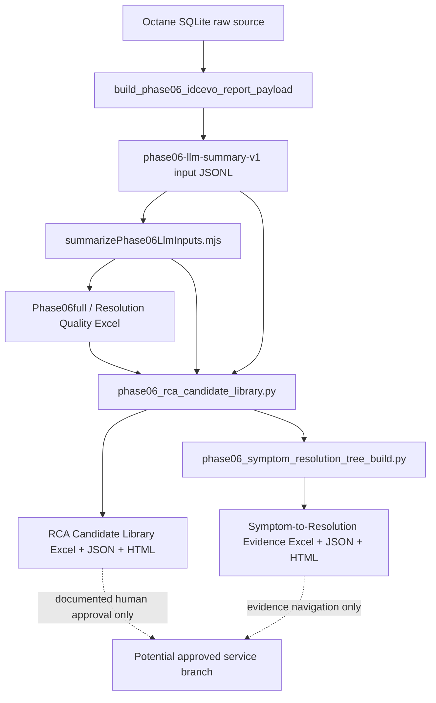

# Phase 06 Resolution-Evidence Lane

## Purpose And Boundary

Phase 06-concluded IDCEVO Tickets are a useful **parallel evidence lane** for
the Phase 09 after-sales workflow. They are not a replacement for Phase 09 and
must not be merged into a Phase 09 V12/V1 artifact by copying rows.

Phase 06 contributes Ticket-recorded repair-plan and decision evidence that is
often closer to a recorded resolution than a Phase 09 rejection/closure record.
It still does not prove that a repair is technically correct, applicable to a
vehicle, deployed in a release, or positively verified.

The Phase 06 implementation belongs to the Vizion Lab repository. The external
`C:\Users\q446328\Desktop\datahub` application has no standalone Phase 06
input pipeline, artifact source, or LLM runner.

## Current Verified Snapshot

Read-only audit on 2026-09-23 found the same data in both:

```text
exports\idcevo_phase06\Phase06full.xlsx
exports\idcevo_phase06\IDCEVO_Phase06_Resolution_Quality_20260917.xlsx
```

| Measure from `05_全部明细` | Count | Rate of 19,316 unique Tickets |
| --- | ---: | ---: |
| Repair Plan Evidence | 145 | 0.75% |
| Decision Evidence | 32 | 0.17% |
| Repair Plan OR Decision Evidence | 176 | 0.91% |
| Repair Plan AND Decision Evidence | 1 | 0.01% |
| No-Fix Evidence | 18 | 0.09% |

This means Phase 06 has the **right evidence fields**, but the current snapshot
is not a large verified-solution library. Describe it as a prioritized remedy
evidence source, not as 19,316 validated repair instructions.

## Native Lineage



The source database is resolved through the same Vizion Lab database
configuration as Phase 09. A full rebuild uses the current raw source, normally
`database/source/qgate_raw.db`, rather than DataHub's local tool-catalog SQLite.

## Inputs And Outputs

### Source Workbook Contract

The Phase 06 review and navigation builders require `05_全部明细` and these
fields:

```text
Ticket ID
功能
Solution Cluster
Defect Category
Assigned ECU
Software Version
关闭处置
Ticket 标题
问题描述摘录
证据原文索引
修复计划证据
决策证据
无修复证据
```

### LLM Contract

`phase06-llm-summary-v1` includes every Phase 06-concluded Ticket. Valid output
must be `source=llm` and match its Ticket ID, input fingerprint, and input
version. The processing summary is structurally required to contain exactly:

```text
根因：
修复质量：
Reject/关闭原因：
后续闭环：
风险判断与逃逸回顾：
```

The runner analyses root-cause quality, fix quality, and field-escape evidence.
It is a bounded candidate assessment, not an authority to invent a root cause,
customer impact, repair instruction, or verification result.

### Candidate Library

`backend/analytics/phase06_rca_candidate_library.py` creates:

```text
IDCEVO_Phase06_RCA_Candidate_Library_V1.xlsx
IDCEVO_Phase06_RCA_Candidate_Library_V1.json
IDCEVO_Phase06_RCA_Candidate_Library_V1.html
```

P1 means an LLM causal signal, raw remedy evidence, and an evidence reference
are present without a no-fix signal or root-cause uncertainty. P2 has a causal
or remedy signal but incomplete evidence. Both are review priorities, not
confidence levels or approved rules.

### Resolution-Evidence Tree

`backend/analytics/phase06_symptom_resolution_tree_build.py` creates:

```text
IDCEVO_Phase06_Symptom_to_Resolution_Evidence_Trees_V1.xlsx
IDCEVO_Phase06_Symptom_to_Resolution_Evidence_Trees_V1_Decision_Tree_Knowledge_Base.json
IDCEVO_Phase06_Symptom_to_Resolution_Evidence_Trees_V1_Decision_Tree_Catalog.html
```

Its navigation shape is:

```text
Service Function
  -> Issue Group
  -> Symptom Pattern
  -> Trigger Pattern
  -> Recorded Resolution Evidence
```

The terminal copies only a nonblank Ticket `修复计划证据` or `决策证据`. When
neither exists, the terminal is `No recorded resolution evidence`; that label
means an evidence gap, not an escalation or repair action.

## Run Modes

### Audit Existing Phase 06 Evidence

Use read-only inspection for source-workbook headers, unique Ticket IDs,
evidence-field coverage, LLM input/output fingerprints, P1/P2 counts, and zero
automatic rules. Do not regenerate artifacts merely to inspect them.

### Rebuild Candidate Artifacts From Validated Inputs

Use this only when a matching Phase 06 workbook and validated JSONL cache
already exist:

```powershell
.venv\Scripts\python.exe -m backend.analytics.phase06_rca_candidate_library `
  --workbook "<validated Phase06 workbook.xlsx>" `
  --inputs "exports\idcevo_phase06\llm\phase06_inputs_v1.jsonl" `
  --summaries "exports\idcevo_phase06\llm\phase06_summaries_v1_pro.jsonl" `
  --output-xlsx "exports\idcevo_phase06\candidate\IDCEVO_Phase06_RCA_Candidate_Library_V1.xlsx" `
  --output-json "exports\idcevo_phase06\candidate\IDCEVO_Phase06_RCA_Candidate_Library_V1.json" `
  --output-html "exports\idcevo_phase06\candidate\IDCEVO_Phase06_RCA_Candidate_Library_V1.html"

.venv\Scripts\python.exe -m backend.analytics.phase06_symptom_resolution_tree_build `
  --workbook "<validated Phase06 workbook.xlsx>" `
  --inputs "exports\idcevo_phase06\llm\phase06_inputs_v1.jsonl" `
  --summaries "exports\idcevo_phase06\llm\phase06_summaries_v1_pro.jsonl" `
  --output-xlsx "exports\idcevo_phase06\candidate\IDCEVO_Phase06_Symptom_to_Resolution_Evidence_Trees_V1.xlsx" `
  --output-json "exports\idcevo_phase06\candidate\IDCEVO_Phase06_Symptom_to_Resolution_Evidence_Trees_V1_Decision_Tree_Knowledge_Base.json" `
  --output-html "exports\idcevo_phase06\candidate\IDCEVO_Phase06_Symptom_to_Resolution_Evidence_Trees_V1_Decision_Tree_Catalog.html"
```

### Full Phase 06 Refresh

For a source/LLM refresh, preserve the separate Phase 06 cache and version:

```powershell
.venv\Scripts\python.exe exports\idcevo_phase06\llm\export_phase06_inputs.py

node scripts\summarizePhase06LlmInputs.mjs `
  --input "exports\idcevo_phase06\llm\phase06_inputs_v1.jsonl" `
  --output "exports\idcevo_phase06\llm\phase06_summaries_v1_pro.jsonl" `
  --error-output "exports\idcevo_phase06\llm\phase06_summaries_v1_pro.errors.jsonl" `
  --model deepseek-v4-pro `
  --concurrency 3 `
  --max-retries 2
```

Generate the matching Phase 06 Excel through the owning report writer. Keep it
as a candidate until its inputs and outputs have passed validation:

```powershell
$phase06ExcelScript = @'
from pathlib import Path
from backend.analytics.phase06_idcevo_excel_report import (
  generate_phase06_idcevo_excel_report,
)

generate_phase06_idcevo_excel_report(
  db_path=Path(r"database\source\qgate_raw.db"),
  output_path=Path(r"exports\idcevo_phase06\candidate\Phase06full.xlsx"),
  include_china_specific=True,
  llm_summaries_path=Path(
    r"exports\idcevo_phase06\llm\phase06_summaries_v1_pro.jsonl"
  ),
)
'@
& .venv\Scripts\python.exe -c $phase06ExcelScript
```

Then rebuild the candidate library and evidence-tree triple from that exact
candidate workbook/cache set.

## Promotion Gate

No generated Phase 06 artifact may directly change a Phase 09 V12/V1 branch.
Before a human-approved cross-phase rule is added, record all of the following:

1. Phase 09 customer symptom/trigger and matching service-function scope.
2. Phase 06 raw description, comments/history evidence, and recorded repair or
   decision evidence.
3. A technically specific causal mechanism reviewed by an accountable expert.
4. Applicability constraints: software/hardware version, market, configuration,
   and trigger conditions.
5. Positive verification evidence and its scope; no-fix evidence blocks approval
   until resolved.
6. Approval owner, date, source Ticket IDs, and the target decision-tree branch.

Until then, retain a Phase 06 record as evidence navigation with
`approved_tree_rule = false` and `human_review_required`.

## Focused Validation

```powershell
.venv\Scripts\python.exe -m pytest `
  backend/tests/test_phase06_rca_candidate_library.py `
  backend/tests/test_phase06_symptom_resolution_tree_build.py -q
```

For a candidate rebuild, also verify:

- Detail-sheet Ticket IDs are unique and all required evidence columns exist.
- Every accepted summary has matching Ticket ID, fingerprint, input version,
  `source=llm`, and all five required output sections.
- Candidate-library and evidence-tree JSON report
  `automatic_tree_rule_count: 0`.
- The Phase 06 triple shares one candidate output stem and does not overwrite
  Phase 09 V12/V1 artifacts.
