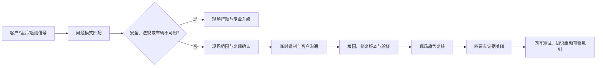

# IDCEVO Phase 09 未解决问题与客户投诉预防研究

## 结论先行

本次工作簿反映的核心风险，不应被理解为 "4,000 多张仍未解决的缺陷单"，而是一个由关闭证据缺失、交付证据缺失、重复问题未追溯和潜在客户现场暴露组成的风险组合。项目应把管理对象从单张 Ticket 转为 "问题模式 + 受影响车辆范围 + 客户信号 + 处置证据"。

最紧急的不是继续提高 Phase 09 关闭量，而是阻断 "没有可复核技术结论的关闭" 被误解为 "客户风险已经消除"。闭环必须同时证明：问题范围、临时遏制或修复、交付版本和验证结果。

## 数据范围与口径

本研究以 [2026-09-07 FinalProject 工作簿](../exports/idcevo_phase09/IDCEVO_Phase09_Closure_Risk_20260907_FinalProject_LLM_Complete.xlsx) 为事实快照，并使用 [2026-09-08 RCA/聚类增强工作簿](../exports/idcevo_phase09/IDCEVO_Phase09_Closure_Risk_20260908_FinalProject_LLM_Complete.xlsx) 做问题模式和证据完整度分析。两个文件使用相同的 2026-09-07 数据源快照；增强版增加了逐条 RCA 和聚类页。

分析范围是最终业务项目 `tproject=IDCEVO`、当前处于 Phase 09、包含 China-specific 功能且排除 CoC finder-team 的 Ticket。工作簿的 "客户现场风险无法排除" 是审计候选标记，不是已经发生客户投诉或问题已经逃逸到量产车的事实结论。是否真实影响客户，必须补充 VIN、车型配置、I-Step/软件版本、售后、经销商、呼叫中心和维修数据后确认。

9 月 8 日版本将旧版 "无充分关闭证据" 队列中的 100 条重新分类为 "Closure evidence incomplete"：其中 36 条仍属于现场风险优先候选，64 条为影响未抬升的监控项。这是规则口径收敛，不是风险自动消失。因此本报告保留这 100 条作为监控债务，不将其计入新版 4,270 条严格直关队列。

## 当前风险画像

| 指标 | 数量 | 解读 |
| --- | ---: | --- |
| 分析范围内当前 Phase 09 Ticket | 18,000 | 全部分析母体 |
| 可接受关闭证据 | 4,424 | 24.6%，具备低风险关闭理由或已验证的关联解决 |
| 有后续/修复跟进证据 | 9,206 | 51.1%，表示被跟进，不等价于已在客户版本交付 |
| 严格无审计依据直关 | 4,270 | 23.7%，需要按风险和问题模式治理 |
| 重新归类的关闭证据不完整监控项 | 100 | 无后续证据，不能从治理范围丢弃 |
| 客户现场风险无法排除 | 4,306 | 3,822 条关闭证据缺口 + 484 条优先现场暴露候选 |
| 优先生产暴露复核 | 931 | 5.2%，需要人工确认实际现场范围和交付状态 |
| QGate 治理严重 | 293 | 1.6%，均无 Target 或后续跟进证据，应进入同日责任人决策 |
| 精确历史路径 `01 -> 09` | 17,697 | 98.3%，是强审计信号，但单独使用不能区分真正高风险 |

`01 -> 09` 覆盖了几乎整个样本，因此它只能用于触发证据检查。高风险判断应叠加严重度、客户影响、修复/交付证据、重开、重复父票状态和现场信号；不能把所有直关一概视为相同风险。

## 最重要的发现

### 1. 关闭原因和交付证据是首要治理缺口

在 4,270 条严格无审计依据直关中：

| 证据缺口 | 数量 | 比例 |
| --- | ---: | ---: |
| 未记录关闭原因 | 2,308 | 54.1% |
| 没有 Target 版本 | 4,270 | 100.0% |
| 没有后续/修复跟进证据 | 4,270 | 100.0% |
| RCA 中可提取到根因文本 | 1,444 | 33.8% |
| RCA 中有重复父票信息 | 442 | 10.4% |
| RCA 中有供应商反馈信息 | 231 | 5.4% |
| RCA 技术证据完整度不高于 `2/4` | 3,977 | 93.1% |

这说明首要问题不是 "RCA 写得不够漂亮"，而是关闭时常缺少最小技术闭环。即使 Ticket 中存在标题、描述或评论，也不能证明实际修复、版本交付或客户侧风险已消除。

### 2. "有跟进" 大多仍缺乏可验证交付承诺

931 条优先生产暴露复核中，903 条没有 Target 版本，占 97.0%。其中 684 条的后续证据仅为 `Reprel change / shift recorded`，736 条显示为有后续/修复跟进。

`Reprel` 变化可说明计划仍在演进，却不能证明以下任何一点：受影响车辆范围已经隔离、软件已发布到目标车型、修复在相同工况下验证通过、客户投诉已下降。因此应单列 "计划存在但交付未证实" 队列，而不是把它与已解决问题合并。

### 3. 重复票关闭不能替代父票已解决的证据

优先复核池中有 713 条的关闭原因是 `Child (Duplicate)`。在整个优先池的关联状态中，612 条关联 Ticket 在当前源不可用，86 条显式关联 Ticket 尚未达到 Phase 06，只有 5 条能确认关联 Ticket 已达到 Phase 06。

对于重复票，关闭判断至少要可追溯到父票的当前状态、根因、适用软件/车型、修复版本和验证记录。否则 "重复" 只是工单处理标签，不能证明客户投诉场景被消除。

### 4. 严重问题需要与一般关闭债务分流

293 条 QGate 治理严重记录全部处于没有 Target 和没有后续证据的队列。其 RCA 技术证据完整度不高于 `2/4` 的比例为 91.1%。它们必须先完成现场范围、临时遏制、责任人和下一次决策时间确认，再开展批量 RCA 清理。

若存在安全、制动、动力、高压、紧急呼叫、法规或车辆不可用迹象，应直接进入项目既有的功能安全、法规和现场行动升级路径。工作簿中的 QGate 标签只能用于筛选，不能替代该专业判断。

### 5. 问题模式集中，适合按簇治理而非逐票消耗

RCA 页面对 C-administrative 与 D-insufficient 类共 9,432 条 Ticket 进行了关键词聚类，得到 4,796 个候选问题模式。104 个规模不少于 10 的候选簇覆盖 1,660 条 Ticket，占该群体的 17.6%。高体量的功能/关闭原因组合包括：

| 候选主题 | Ticket 量 | 推荐用途 |
| --- | ---: | --- |
| Audio Infrastructure + Child (Duplicate) | 249 | 统一核验父票、版本和回归覆盖 |
| Speech CN + Child (Duplicate) | 235 | 建立语音场景、语言包和版本矩阵 |
| Speech CN + Not recorded | 220 | 补录关闭理由，回溯语音投诉症状 |
| ENT_and_CON CN + Child (Duplicate) | 200 | 按手机型号、投屏协议和软件版本归并 |
| CarFunctions + Child (Duplicate) | 183 | 按车辆配置和 ECU 版本确认适用范围 |
| Navigation CN + Not recorded | 168 | 按地图数据、定位、路线和 OTA 版本分析 |

这些是候选问题模式，不是已确认的重复缺陷。现有聚类使用功能、关闭原因与关键词相似度，适合产生复核清单和测试种子；正式合并、对外说明或关闭仍应由功能负责人基于原始证据确认。

## 建议的分层工作队列

下列队列有重叠，不能相加。它们用于决定处理顺序和责任机制。

| 队列 | 当前筛选 | 建议时限 | 必须回答的问题 | 最小输出 |
| --- | --- | --- | --- | --- |
| 红色：严重处置 | 293 条 QGate 治理严重且无交付证据 | 24 小时内责任人决策 | 是否涉及安全、法规、车辆不可用或已知现场车辆？ | 责任人、受影响范围、临时遏制、升级结论、下一次决策时间 |
| 橙色：现场暴露确认 | 484 条 "Production exposure cannot be ruled out - priority review" | 5 个工作日 | 哪些车型/VIN/软件可能受影响？是否有售后或客服同类信号？ | 现场暴露结论、复现计划、客户沟通/维修策略或排除依据 |
| 黄色：计划未交付 | 931 条优先生产暴露复核，尤其是 903 条无 Target 版本 | 一周内 | 计划是否已转化为可交付修复？修复在哪个版本、何时验证？ | Fix/Target 版本、适用范围、验证证据、负责人和日期 |
| 蓝色：关闭证据债务 | 4,270 条严格无审计依据直关 | 分簇后两周内完成首轮 | 关闭原因、根因、父票或责任方、客户影响是否可审计？ | 四要素证据卡或转入风险接受/修复队列 |
| 灰色：规则收敛监控 | 100 条 Closure evidence incomplete | 两周内 | 是低影响的正确关闭，还是被口径排除的真实风险？ | 最小关闭理由、影响判定、保留/升级决定 |

建议将这些时限作为项目运营目标，由质量、产品、售后和供应商团队共同定标，而不是作为自动关闭规则。

## 单个问题应如何分析

每个高优先级 Ticket 都应从 "关闭理由" 转为 "客户问题模式" 的分析。推荐采用以下五步，而不是仅补写 RCA：

1. **明确症状和边界。** 固化客户可感知症状、触发前提、恢复方式、影响功能、车型/市场、ECU、软件/I-Step、首次和最后一次观察时间。将 "无法复现" 区分为实验室无法复现、车辆无法复现、现场日志不足和已被新版本消除。
2. **确认现场暴露。** 将 Ticket 与 VIN/车型配置、交付软件、生产批次、OTA 覆盖、经销商维修单、呼叫中心、保修和远程诊断信号关联。优先计算受影响版本的每千台车案例率，而非只看 Ticket 数量。
3. **建立技术因果链。** 将现象、日志/trace、复现、根因、临时规避、永久修复和验证分开记录。根因文本存在不代表根因已经经过评审，RCA 结论应标注证据链接和置信级别。
4. **确定处置策略。** 对每个问题模式明确是现场遏制、软件修复、服务行动、产品说明、供应商纠正、风险接受还是关闭。`Child (Duplicate)` 必须指向一个可访问、已验证的父票闭环。
5. **验证客户结果。** 修复后在同一软件/配置/操作路径回归，监控对应客户/售后信号是否下降，再决定技术和客户沟通层面的关闭。

### 最小闭环证据卡

新的 Phase 09 或风险接受前，应有以下四项。缺任一项时，系统应保留在治理队列而非只改变状态：

| 证据项 | 最小内容 | 可接受证据 |
| --- | --- | --- |
| 根因和适用范围 | 根因、受影响条件、未受影响边界 | 分析记录、trace、供应商确认或父票 RCA |
| 处置/遏制 | 当前客户如何被保护，或为何不需要保护 | 临时规避、服务说明、配置限制、风险接受批准 |
| 交付承诺 | 修复或决定进入的版本、车型范围、日期和负责人 | Target/Fix version、发布计划、商业解决日期 |
| 验证结果 | 在目标版本和代表性车辆上验证的结果 | 回归用例、车辆测试、监控趋势、父票验证记录 |

对于 "预期行为"、"用户错误"、"不可复现" 和 "重复票"，也应适用该卡片：这类理由可以成立，但必须能够解释为什么客户不需要修复、如何避免同类投诉再次进入，以及谁对这一结论负责。

## 投诉预防与应对的数据闭环

### 统一问题键

建立 `issue_pattern_id`，将同一问题模式的 Ticket、投诉和处置证据聚合。建议键至少由以下内容组成：

| 数据域 | 关键字段 |
| --- | --- |
| 产品与范围 | 功能、ECU、车型/配置、市场、软件/I-Step、生产/OTA 批次 |
| 现象 | 客户症状、触发条件、频度、恢复动作、日志特征 |
| 工程闭环 | Ticket/父票、根因、修复、临时遏制、验证证据、供应商责任 |
| 现场信号 | VIN、经销商维修、保修、呼叫中心、App/车机遥测、投诉时间与严重度 |
| 经营动作 | 责任人、SLA、客户沟通、服务措施、行动状态和完成时间 |

Ticket ID 仍保留为证据源，但不应是客户投诉分析的唯一主键。一个问题模式可以有多张重复 Ticket，也可以同时产生多个客户案例。

### 每周风险评审应看的指标

| 指标 | 公式或判断 | 用途 |
| --- | --- | --- |
| 现场案例率 | `同一问题模式的客户/维修案例 ÷ 受影响软件和配置车辆数 x 1,000` | 比较版本、车型和市场的真实风险 |
| 关闭证据完整率 | `具备四要素证据卡的 Phase 09 数 ÷ 新关闭数` | 防止以状态替代闭环 |
| 计划转交付率 | `有 Fix/Target 版本且已验证的项 ÷ 仅有计划或 Reprel 的项` | 识别计划长期不落地 |
| 重复关联完整率 | `有可访问父票且父票有验证闭环的重复票 ÷ 重复票` | 防止重复标签掩盖未解决问题 |
| 问题逃逸率 | `关闭后首次出现的关联客户案例 ÷ 已关闭问题模式` | 衡量关闭质量和测试缺口 |
| 遏制时长 | 从首个高风险信号到临时保护措施的时间 | 衡量客户响应速度 |
| 复发率 | 修复/服务措施后同模式案例率是否下降 | 验证永久纠正措施是否有效 |

其中现场案例率的分母必须是实际可能受影响的车辆，不宜用全部保有量稀释风险。低样本问题可以使用绝对案例数和趋势共同判断。

### 客户投诉到工程处置的流程

投诉受理侧应返回一个受控状态，而非仅告知 "已知问题"：当前严重度、是否需要立即到店/停止使用、已知临时措施、预计下一次更新节点和负责渠道。对外文案、法规判断和客户补偿需由相应业务及法务流程批准。

## 测试与预防机制

高频簇和已出现过客户症状的模式应进入回归资产，不应只留在关闭历史中。对每个确认模式建立：

- 代表性客户操作路径和前置配置；
- 受影响软件/车型/手机型号/语言包/地图数据矩阵；
- 可采集的日志关键字与诊断信号；
- 修复前失败、修复后通过的可复用验证；
- 与投诉模式绑定的监控阈值。

例如，Navigation CN 的同类场景应按地图数据、定位、路线、网络和软件版本拆分；Speech CN 应按语言、云端可用性、座舱配置、语料和版本拆分；ENT/投屏类问题应按手机型号、OS、协议、应用版本和车机软件拆分。不能只按功能名称聚合，否则会把不同根因混成同一个投诉主题。

对于 104 个规模至少 10 的候选簇，先由功能负责人确认是否为同一问题模式；确认后再生成回归测试、监控规则和父票关系。关键词聚类应是发现工具，不应自动触发 Ticket 合并或客户沟通。

## 系统与流程改造建议

### 关闭准入

在 Octane/QGate 的 Phase 09 流程中实施分级准入：

- QGate 严重、客户影响、重开、无修复声明、重复父票不可用等信号出现时，强制补齐四要素证据卡并指定责任人。
- `Child (Duplicate)` 必须有可点击父票、父票当前阶段、适用范围和验证证据；父票不可访问时不能作为自动关闭依据。
- `Reprel change / shift` 只能标记 "计划跟进"，不可自动视为 "已解决" 或降低客户暴露优先级。
- 对 "用户错误"、"预期行为"、"不可复现" 保留轻量路径，但仍需记录场景、排除依据和预防同类投诉的动作。
- 新关闭票的关闭原因设为必填。现有 2,308 条原因缺失应按功能簇集中补录，避免逐条孤立处理。

### 自动化的边界

LLM 适合从评论和历史中提取症状、候选根因、父票、版本、证据缺口和相似问题，也适合帮助客服/售后快速检索已知模式。但 LLM 输出不能被当作关闭证据。每个自动结论应保留原始评论、历史事件或附件链接，并由功能、质量或售后责任人确认。

同样，重复聚类需要保留候选、已确认和拒绝合并三种状态。项目现有的严格父票关系和双模型复核机制可作为辅助证据，但技术上下文冲突、车型/ECU/软件不一致时必须隔离处理。

### 分阶段落地

| 周期 | 重点动作 | 可验收结果 |
| --- | --- | --- |
| 0-2 天 | 293 条严重项和 484 条现场暴露候选建立责任人与现场范围判定 | 每条有负责人、下一次决策时间和临时遏制/排除结论 |
| 第 1-2 周 | 按问题簇清理 4,270 条关闭证据债务；优先核验 713 条重复关闭 | 每个簇有父票/责任方、四要素缺口和处理计划 |
| 第 3-6 周 | 接入 VIN/软件、售后、客服和维修数据；建立 issue pattern 映射 | 可按问题模式、软件、车型和市场计算现场案例率 |
| 一个发布周期 | 将已确认高频模式转为回归与发布门禁 | 修复版本有目标车辆验证和上线后趋势复核 |
| 一个季度 | 看计划转交付率、逃逸率和复发率，调整关闭规则 | 关闭质量而非关闭数量成为质量 KPI |

## 外部方法论对齐

该模型与两类成熟实践一致，但不声称仅凭本报告即可满足任何认证或法规义务：

- [ISO 10002:2018](https://www.iso.org/standard/71580.html) 强调投诉处理、投诉分析与评价、过程审计以及对有效性和效率的评审。这里将 Ticket 闭环与客户信号联动，正是为了形成这一改进循环。
- [Automotive SPICE 4.0](https://vda-qmc.de/en/automotive-spice/) 强调过程结果、已明确责任、计划监控、系统化归档和质量保证。四要素证据卡、责任人/SLA 和可追溯原文是将这一原则落到问题解决过程的最小实现。

## 实施时的注意事项

1. 不要把工作簿的风险标签直接当作客户投诉事实。先与现场数据交叉验证。
2. 不要按 4,270 张 Ticket 逐张平均分配资源。先按严重度、现场信号、受影响车辆和问题簇排序。
3. 不要因 `01 -> 09` 路径而自动判定高风险；该路径在当前样本中太普遍，必须结合证据和影响。
4. 不要把 Reprel、父票名称、LLM 摘要或关键词相似度视为修复交付证明。
5. 不要让 "关闭数量" 成为单独 KPI。应同时考核证据完整率、计划转交付率、问题逃逸率、遏制时长和复发率。

通过以上方式，当前的关闭风险工作簿可以从一次性审计清单升级为持续的客户投诉早期预警、工程闭环和产品质量改进机制。
