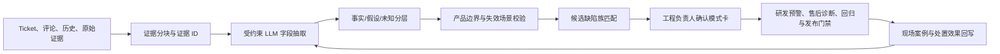

# IDCEVO Phase 09 全量 LLM 摘要：生产逃逸风险与早期预警研究

> **目的：** 评估当前 Phase 09 的全量 LLM 摘要能否支持软件工程分类、RCA、问题模式归纳，以及面向线上/售后的生产逃逸早期预警；并明确哪些结论必须回到原始工程和现场证据确认。

## 结论先行

可以做，而且现在的工作簿已经具备一个可用的第一层数据底座：每张 Ticket 都有统一的发现/处理过程摘要、生命周期和关闭证据、风险规则字段、候选 RCA、以及保守去重簇。它能够把人工从逐票阅读 18,000 张单据，转到审核有限数量的“问题模式 + 风险证据缺口”队列。

但它目前不能仅凭 LLM 摘要判断“会逃逸到生产”或“已经有现场问题”。更准确的说法是：它能识别 **生产暴露无法排除**、**关闭/修复证据不足** 和 **同类问题可能复发** 的候选对象。生产逃逸需要再结合受影响软件版本、车型/VIN、发布范围、售后维修、客服投诉和车端信号确认。

应将分析对象从单张 Ticket 转为以下可追溯的单位：

$$
\text{Ticket 证据} \rightarrow \text{失效场景} \rightarrow \text{缺陷族/问题模式} \rightarrow \text{受影响范围} \rightarrow \text{处置与现场信号}
$$

这能把“没有解决方案的拒绝票”从静态遗留清单，转为可运营的预警、研发闭环和售后知识资产。

## 工作簿事实基线

数据源为 [2026-09-08 FullLLM 工作簿](../exports/idcevo_phase09/IDCEVO_Phase09_Closure_Risk_20260908_FullLLM_Complete.xlsx)。分析母体为最终项目 `tproject=IDCEVO`、当前处于 Phase 09 的 18,000 条记录。工作簿包括总览、拒绝原因、功能风险、生产暴露、无解决方案关闭和全部明细六个数据页；“全部明细”有 66 列，保存了工程、风险、RCA 和去重相关字段。

| 已验证事实 | 数量 | 含义 |
| --- | ---: | --- |
| 全部明细 Ticket | 18,000 | 可作为统一分类和模式发现的母体 |
| 固定五段摘要齐全 | 18,000 | 每条都有问题、处理过程、关闭原因、后续闭环、风险待核实五个段落 |
| LLM 生成摘要 | 17,999 | `deepseek-v4-pro` 13,738 条、`deepseek-v4-flash` 3,133 条、`qwen3.7-flash` 1,128 条 |
| 规则回退摘要 | 1 | 不能与 LLM 抽取质量混为一谈，应进入补生成/人工检查队列 |
| 生产暴露无法排除 | 4,306 | 3,822 条关闭证据缺口，484 条优先生产暴露复核；两类都不是已发生现场问题的证明 |
| 优先生产暴露复核 | 931 | 应首先确认版本、车型/VIN、发布范围、临时遏制和现场同类信号 |
| 决策-证据冲突 | 1,425 | 关闭语义与影响/证据存在冲突，需要工程审查，但不应自动等同于现场逃逸 |
| 严格无审计依据直关 | 4,270 | 无可接受关闭理由或后续/修复证据的重点闭环债务 |
| 无解决方案关闭 | 688 | 应单列为“未解决但关闭”，不能并入已验证修复 |
| C/D 类候选去重簇 | 4,796 | 用于发现候选缺陷族，不可自动认定为同一根因 |

当前关闭处置呈现三个主群和一个监控群：9,206 条有后续/修复记录，4,424 条有可接受关闭证据，4,270 条是严格无审计依据直关，另有 100 条关闭证据不完整。`Follow-up / remediation recorded` 只说明存在计划、关联或活动痕迹，不能替代已实施、已验证、已发布的工程事实。

## 必须先修复的证据链断点

当前 FullLLM 文件的每条“证据原文索引”都指向 `08_证据原文`，但该工作簿只包含 00–05 六个 sheet，并没有实际证据页。因此，单独把它发给工程师或售后时，LLM 摘要、RCA 候选和预警结论无法在文件内回查原文。这是预警系统上线前必须修复的数据产品问题。

好消息是，[9 月 8 日 RCA/聚类增强版](../exports/idcevo_phase09/IDCEVO_Phase09_Closure_Risk_20260908_FinalProject_LLM_Complete.xlsx) 保留了 `08_证据原文`、聚类和逐条 RCA 页，并且它的 18,000 个明细 Ticket 与 FullLLM 完全一致。按 `Ticket ID` 比对后，两个版本的标题、问题描述摘录、关闭处置、风险层级和关闭原因均为零差异；增强版的证据页也覆盖全部 18,000 个 Ticket。

因此可建立一个受控的逻辑数据集：以 FullLLM 的 `05_全部明细` 提供全量摘要，以增强版的 `06_全部明细`、`08_证据原文` 和 `12_逐条RCA分析` 提供证据与结构化候选。这个 join 应在每次生成时校验行数、唯一 Ticket ID、版本快照、关键字段哈希和证据覆盖率，而不是依赖人工记住两个 Excel 的关系。最终交付物应保留这几个 sheet，或在每条模式卡中携带可点击的原文证据 ID。

## 全量 LLM 摘要带来的能力

### 可以可靠用于发现和归纳的内容

- 把标题、描述、评论和生命周期信息压缩为统一阅读入口，支持按症状、触发条件、恢复动作、版本、功能、关闭原因和风险信号检索。
- 自动发现“证据缺失”而非假装补齐证据，例如未记录关闭理由、没有 Target、没有关联父票、无明确修复计划或 Phase 09 后重开。
- 将 C-administrative 与 D-insufficient 的 Ticket 归入候选去重簇，优先从规模较大的失效模式开始人工确认。
- 为线上/售后提供“已知问题候选”的检索上下文：客户症状、前置条件、可能受影响的软件/配置、当前关闭状态和需进一步核实的信息。

### 不能直接作为工程或现场事实的内容

- LLM 概括出的根因、解决方案、重复关系和客户影响，除非能引用原始评论、日志、父票、变更或测试工件。
- `Target version`、`Reprel change`、计划窗口和商业日期。这些是计划或流转证据，不是构建已发布或修复已验证的证据。
- `Child (Duplicate)`。只有子票的失效机理、适用范围和验证结果均匹配一个可访问且已验证的父票，才可以将其视作有效重复关闭。
- “无法复现”。它可能表示问题已消失，也可能表示基线、配置、日志、时序或可观测性不足。

候选 RCA 字段的覆盖度可以帮助排序，但不能替代准确性验证：18,000 条中，候选根因文本为 8,472 条，候选重复父票为 3,670 条，供应商反馈为 6,441 条，观察行为为 15,844 条，期望行为为 15,384 条，恢复动作为 13,914 条。抽样中可见模板残片和格式文本被抽到“根因/恢复”字段，因此这些字段应被命名为 **候选提取**，并增加来源引用与人工确认状态后才可进入正式 RCA。

## 当前高风险队列的真实含义

当前有 2,356 条 Ticket 处于 `Priority production-exposure review` 或 `Decision-evidence conflict`：前者 931 条是应优先确认生产暴露的候选，后者 1,425 条是“决策与证据不一致”的研发/治理审查对象。二者都值得优先处理，但不能合并后称为“2,356 条可能已经逃逸到生产”。

在这 2,356 条高优先级记录中，877 条没有候选根因文本，521 条没有期望行为候选，171 条没有恢复动作候选，2,330 条没有结构化“修复计划证据”字段。字段非空也不等同于证据有效，因此这个数字更适合回答“从哪里开始补事实”，而不能回答“哪些问题已经修好”。

按“功能/解决方案簇 + 关闭原因 + 完整度”聚合，高频组合包括：

| 候选组合 | 高优先级 Ticket | 工程上的首个核验动作 |
| --- | ---: | --- |
| CarFunctions + `Child (Duplicate)` + Lost follow-up risk | 71 | 核验父票、ECU/配置和修复版本是否真实覆盖子票 |
| Audio Infrastructure + `Child (Duplicate)` + Lost follow-up risk | 51 | 核验音频路由/源切换场景与父票回归范围 |
| Navigation CN + `Expected behaviour` + Lost follow-up risk | 49 | 对照需求/地图数据/版本边界，确认“预期行为”并非未解决差异 |
| Wireless Services + `Not reproducible` + Lost follow-up risk | 45 | 固化手机、协议、网络和车机版本的最小复现基线 |
| CarFunctions + `Expected behaviour` + Lost follow-up risk | 41 | 追溯规格、配置与安全/可用性影响，补充验证证据 |
| SDI + `Not reproducible` + Lost follow-up risk | 38 | 检查显示/投屏/应用版本矩阵和诊断日志条件 |
| Core UI + `Child (Duplicate)` + Lost follow-up risk | 37 | 验证界面状态机故障与父票的触发、恢复和版本范围 |
| Entertainment + `Not reproducible` + Lost follow-up risk | 36 | 以媒体源、账号、网络和软件版本建立可重复场景 |
| Personalization + `Child (Duplicate)` + Lost follow-up risk | 35 | 核验账号状态、同步链路和父票适用范围 |
| Speech CN + `Expected behaviour` + Lost follow-up risk | 34 | 将语料、语言包、云端可用性和意图版本纳入规格/回归核验 |

这些是 **治理和审查组合**，不是已确认的共同根因。它们适合用来建立专题工作坊、选择原始 Ticket 样本和设计预警规则，不能据此自动合并 Ticket 或对外发布统一解决方案。

## 分类、暴露与关闭完整度必须分开看

当前工作簿中 `风险层级=Priority production-exposure review` 有 931 条，而 `客户现场风险判断=Production exposure cannot be ruled out - priority review` 有 484 条。这两个字段名称相近、用途不同：前者是综合排序标签，后者是当前暴露判断。系统应将它们改名为 `closure_risk_priority` 和 `production_exposure_assessment`，避免运营人员把二者当成同一个“生产故障数”。

下表把四类拒绝分类与两个维度并列。最后一列包括“优先复核”和“关闭证据缺口”两种 `production exposure cannot be ruled out` 状态，仍然是待确认风险，而非现场事实。

| Reject Classification | Ticket | 综合优先级为 P1 | 生产暴露无法排除 | 应采取的主动作 |
| --- | ---: | ---: | ---: | --- |
| A-acceptable | 5,435 | 6 | 19 | 回查少量异常组合，维持低风险关闭抽检 |
| B-planned-deferral | 3,133 | 29 | 0 | 验证风险接受的到期日、遏制与后续重审条件 |
| C-administrative | 5,748 | 714 | 686 | 优先处理重复父票、管理决策和跟进未落地问题 |
| D-insufficient | 3,684 | 182 | 3,601 | 补齐最低事实与暴露范围，不能按已解决统计 |

D-insufficient 中有 $3,601 / 3,684 = 97.7\%$ 处于“生产暴露无法排除”状态。这并不说明 $97.7\%$ 会进入量产，而说明其关闭证据不足以排除量产影响；它应进入 P3 闭环债务与版本范围核验，而非直接成为售后公告。

688 条 `Closed without solution` 也需单独治理：680 条的关闭原因是 `Management decision`，686 条属于“生产暴露无法排除”的两档。这是一个“未解决但流程结束”的决策债务队列。其正确处置不是让 LLM 猜一个解决方案，而是补齐风险接受边界、临时客户保护、到期日、复审条件和责任人；没有这些内容时，不应被视作已解决。

931 条综合优先级 P1 的证据缺口进一步说明，预警首先需要是“要求确认”的工作流：

| P1 信号 | Ticket | 比例 | 含义 |
| --- | ---: | ---: | --- |
| 没有 Target 版本 | 903 | 97.0% | 不能确认修复是否进入目标构建 |
| 没有结构化修复计划证据 | 905 | 97.2% | 需要回查原文、父票、变更或服务措施 |
| 无明确父票或父票在源中不可用 | 840 | 90.2% | `Child (Duplicate)` 不能自动解释为已解决 |
| `QGate 严重=是` | 810 | 87.0% | 表示需要优先工程判断，不自动等同于安全事件 |
| 没有候选根因文本 | 212 | 22.8% | 需要先确定现象、基线和最小诊断计划 |
| 关闭原因为 `Child (Duplicate)` | 713 | 76.6% | 父票范围匹配是最重要的首个核验动作 |

## 不应使用单一“逃逸分数”

生产逃逸风险至少包含三个不同问题，不能由一个 LLM 标签混在一起：

| 维度 | 要回答的问题 | 当前工作簿的可用信号 | 必须补充的事实 |
| --- | --- | --- | --- |
| 暴露可能性 | 有问题的软件/配置是否可能到达客户？ | 软件版本、Target、计划、关闭时间、直接关闭、父票状态 | 发布清单、I-Step、车型/VIN、OTA/生产范围 |
| 后果与可检测性 | 客户遇到后影响多大、能否恢复、能否快速识别？ | QGate/BI、客户可感知症状、恢复动作、重开、功能域 | 安全/法规判断、车端诊断、实际案例率 |
| 控制有效性 | 是否有已验证的修复、遏制或服务措施？ | 修复/决策证据、重复父票、RCA 候选、后续状态 | commit/配置变更、构建、回归执行、服务措施效果 |

因此，优先级应采用门控而不是宣称未经校准的概率：

1. **P0 现场行动候选：** 安全、法规、车辆不可用或高影响症状，且暴露范围存在或无法快速排除，同时没有已验证遏制。
2. **P1 生产逃逸复核：** 931 条优先生产暴露复核，以及命中高影响、重开、未验证重复关系、无修复方案等组合信号的模式。
3. **P2 模式预警：** 同一失效场景在多个 Ticket、版本、车型、市场或售后渠道重复出现，但尚无直接客户证据。
4. **P3 闭环债务：** 关闭理由、RCA、版本、验证或父票证据不完整；需要工程补证据，不宜直接推送给客户渠道。

其中 P0/P1 是需要责任人和时限的工作队列，P2 是线上/售后可检索和监测的知识预警，P3 是研发治理队列。四类允许重叠，但不能相加后当成“生产故障数”。

## 建议的分类与 RCA 数据模型

现有 `Reject Classification` 与 `Closure Completeness` 是良好的第一维：A-acceptable、B-planned-deferral、C-administrative、D-insufficient；以及 Closed with evidence、Accepted risk with traceability、Lost follow-up risk、Closed without solution、Insufficient closure evidence。下一步不应让 LLM 再生成一个互相重叠的总分类，而应补齐相互独立、可审核的维度。

| 分类维度 | 推荐枚举或结构 | 用途 |
| --- | --- | --- |
| 失效场景 | 症状、实际/期望行为、触发步骤、恢复动作、频度 | 支持复现、售后匹配和回归测试 |
| 产品边界 | 功能、组件/ECU、车型、市场/语言、软件/I-Step、配置、外部设备 | 避免把同一 UI 症状误合并成同一根因 |
| 工程根因 | 需求/规格、设计、实现、接口集成、配置/编码、数据/内容、时序/资源、环境/硬件、供应商、测试、诊断、未知 | 用于缺陷预防和责任改进 |
| 逃逸原因 | 覆盖缺口、环境/版本矩阵缺口、可观测性不足、发布门禁缺口、重复票追溯失败、关闭治理缺口 | 用于建立预防控制而非只写 RCA |
| 处置状态 | 已验证修复、已计划修复、已验证临时规避、已验证非缺陷、有效重复、受控风险接受、证据不足 | 使“已解决”和“流程关闭”可区分 |
| 证据等级 | E0 报告、E1 复现、E2 根因、E3 纠正、E4 验证、E5 交付、E6 上线有效性 | 防止 LLM 文本或计划字段被当成修复事实 |
| 置信与出处 | 字段值、原文证据 ID、抽取置信度、工程确认人、确认时间 | 让每个自动建议可复核、可纠错 |

RCA 的核心关系应为：

$$
\text{现象} \rightarrow \text{受控复现} \rightarrow \text{因果证据} \rightarrow \text{纠正变更} \rightarrow \text{验证} \rightarrow \text{目标构建} \rightarrow \text{现场有效性}
$$

其中任一环缺失时，系统应明确显示“缺失在哪一环”，而不是生成看起来完整的自然语言 RCA。

## 把 LLM 变成证据抽取器，而不是裁决器

目前的五段自然语言摘要非常适合阅读和召回，但不适合直接做统计学习或客户提示。模型来源也混合了三个 LLM；当前分布是 `deepseek-v4-pro` 13,738 条、`deepseek-v4-flash` 3,133 条、`qwen3.7-flash` 1,128 条。不同模型覆盖的风险队列不同，因此不能从当前工作簿比较模型准确率。下一轮处理应将所有摘要重新抽取到同一版本的结构化 schema，并保留每个字段的原文出处。

每一个 LLM 字段应至少保存以下信息：

| 字段 | 自动输出 | 允许值 | 必须附带的信息 |
| --- | --- | --- | --- |
| 症状/实际行为 | 客户或测试可观察现象 | 文本 + 结构化症状标签 | 原始描述或评论证据 ID |
| 触发与基线 | 操作、环境、版本、配置、设备 | 已知 / 未知 / 冲突 | 引用片段和字段来源 |
| 根因 | 因果机制候选 | 已确认 / 假设 / 未知 | 证据 ID、置信度、工程确认状态 |
| 处置 | 修复、临时措施、风险接受或无措施 | 已验证 / 已计划 / 候选 / 无 | 变更、测试、服务或批准记录 |
| 版本与范围 | ECU、车型、市场、I-Step、外部设备 | 包含 / 排除 / 未知 | 来源与范围确认人 |
| 模式匹配 | 相同失效机理候选 | candidate / confirmed / rejected | 正证据、反证据、审核人 |

字段必须允许 `unknown`，而不是要求模型填满。若不存在原文证据，模型输出应为“未找到证据”，不应输出看起来合理的根因或解决方案。对于根因、处置、受影响范围和客户指导，只有存在两个独立来源或一次责任人确认后，才能从候选升级为可运营事实。

现有 RCA 候选也验证了这项门槛的必要性：8,472 条非空根因候选中，至少 558 条命中模板/格式残留规则；13,914 条非空恢复动作候选中，13,047 条（93.8%）命中 `from error`、`actions/steps` 等模板残留。这个扫描只是明显错误的下限，不能推断其余字段一定正确。因此第一版预警不得从 `RCA Recovery Action` 自动发布“解决方案”；应以重新抽取、证据引用和人工审核后的处置字段为准。

## 缺陷族归纳的正确方法

当前 C/D 人群的 9,432 条 Ticket 被归为 4,796 个候选去重簇。其中 1,551 个簇具有至少两个成员，覆盖 6,187 条 Ticket；理论上可减少 4,636 次重复的人工阅读，但这不是可以自动合并或自动关闭的数量。

模式归纳应使用“软召回 + 硬约束 + 人工确认”三段式：

1. **软召回。** 用摘要、标题、观察行为和关键词/向量相似度找候选，优先召回，不做最终结论。
2. **硬约束。** 比较 ECU/组件、软件基线、车型/市场、触发条件、症状、父票、恢复动作和时间窗口。不一致时进入隔离候选，而不是强行归类。
3. **人工确认。** 工程负责人确认相同失效机理、共同修复适用范围和回归范围后，才创建稳定的 `issue_pattern_id` 或 `defect_family_id`。

对售后而言，模式的匹配主键应首先是可观察症状、前置条件、软件/配置和恢复动作，而不是内部“根因”。同一症状可能由不同原因造成；同一根因也可能在不同车型或语言包中表现不同。模式卡必须同时记录正例、反例和不适用边界，防止将相似 HMI 表象误报为同一问题。

## 最小可行的预警产品

预警不应向线上/售后批量发送 4,306 或 18,000 条 Ticket。应当按已确认或高置信候选问题模式生成一张“模式卡”，并由研发质量、功能负责人和售后共同确认后发布。

每张模式卡至少包含：

- `issue_pattern_id` 和关联 Ticket/父票；
- 客户可感知症状、前置条件、恢复动作和不适用边界；
- 受影响的车型、市场、语言、ECU、软件/I-Step、手机/协议或数据版本；
- 当前工程判断：已验证、待复现、待根因、待修复、已遏制、受控风险接受或证据不足；
- 现场风险级别、触发原因、责任人、下一次复核时间；
- 经批准可给售后使用的诊断问题、日志采集项、临时建议和升级路径；
- 原始证据、测试、变更、发布和现场案例的链接，而非仅保留 LLM 摘要。

建议上线两类提示：

| 提示对象 | 触发方式 | 应展示的内容 | 不应展示的内容 |
| --- | --- | --- | --- |
| 研发/质量 | P0/P1 命中、证据超期、同模式新增、父票失效或 Phase 09 后重开 | 缺失证据层、相似 Ticket、受影响边界、待执行的确认动作 | 未经确认的“根因已确定”或“已修复” |
| 线上/售后 | 已确认模式与投诉/维修/遥测信号匹配，或 P0 需要主动处置 | 经批准的症状匹配、诊断路径、临时措施、升级联系人和版本范围 | 原始 LLM 推理、内部责任归因、未验证解决方案 |

### 没有解决方案时，预警应该做什么

没有永久修复方案不意味着系统无事可做，但也绝不能编造建议。每个 P0/P1 模式需要单独记录以下处置状态，并决定可否面向售后发布：

| 当前状态 | 工程侧动作 | 售后/线上可见动作 |
| --- | --- | --- |
| 已验证临时遏制 | 验证适用版本、限制和失效条件 | 仅发布已批准的诊断与临时措施 |
| 正在复现或根因未知 | 固化基线、日志包、责任人与下次评审 | 提示收集哪些环境/日志，匹配后升级，不给“修复”承诺 |
| 修复已计划但未验证 | 关联变更、目标构建和回归退出条件 | 仅显示受控的更新时间节点，不称“已解决” |
| 风险接受/管理决定 | 记录影响边界、替代控制、到期日和重新评审条件 | 由质量/法务/售后批准是否需要客户沟通 |
| 无措施、无证据 | 阻止默认关闭，进入 P1/P3 责任人队列 | 不发布为已知解决方案 |

对客户渠道而言，最有价值的预警常常不是“根因是什么”，而是“此症状在什么版本/配置下需要怎样诊断、是否有安全限制、是否应立即升级”。这能显著减少一线将不同问题误归类、重复试错或承诺不存在的修复。

## 对三层方案的设计评审

附件提出的“单票结构化 RCA -> 问题模式归纳 -> 生产逃逸预警”三层方向是正确的，并且比继续扩充叙事摘要更接近可运营产品。它准确抓住了四条逃逸路径：重复父票未闭环、特定条件下的不可复现、非缺陷/测试质量判断错误，以及管理决策或容忍没有被持续控制。

但实施时必须校正统计口径、字段责任和评分语义。否则系统会把“证据未知”误显示为“已知高逃逸概率”，或者把 LLM 对工单文本的猜测推给售后当成解决方案。

### 四条路径：保留方向，修正口径和控制点

| 路径 | 附件中的核心判断 | 工作簿验证结果 | 应建立的控制点 |
| --- | --- | --- | --- |
| A：重复关闭 | 父票未真正解决，子票在生产再次出现 | 全量有 7,701 条 `Child (Duplicate)`；C/D 范围内为 3,742 条。C/D 中仅 1,441 条有候选 `RCA Duplicate Parent`，且按正式关联状态没有一条可确认父票在当前 Phase 09 前后达到 Phase 06 | 将“候选父票文本”与“正式关系、父票当前阶段、父票验证、子父适用范围匹配”分开。父票状态必须由确定性数据 join 生成，不能由 LLM 断言 |
| B：不可复现 | 条件特定，客户/生产场景可能命中 | 附件的 3,405 是准确的组合池，但不是 3,405 条 `Not reproducible`：它等于 2,425 条 `Not reproducible` + 325 条 `Further traces necessary` + 655 条 `Additional Information necessary` | 改称“复现/可观测性不足”。分别提取实验室已观察条件、待补条件和生产可达条件；缺失条件只触发工程补证据，不自动触发售后红色告警 |
| C：非缺陷/测试质量关闭 | 预期行为、用户或测试判断可能错误，真实问题被掩盖 | 附件的 2,979 也是准确组合池：2,427 条 `Expected behaviour` + 274 `User Error` + 113 `Invalid Testcase` + 98 `Measuring Tool Issue` + 67 `Insufficient Defect Quality` | 不把它统称为“预期行为”。每种结论必须有不同独立反证：需求/设计条款、测试用例和执行证据、测量工具校准或用户操作边界 |
| D：行政关闭/容忍 | 已知风险可能被带入生产但没有到期跟踪 | 附件的 1,456 是准确组合池：1,013 `Management decision` + 71 `Tolerated` + 328 `Function not implemented/testable yet` + 44 `CR - conceptional issue`。其中仅 25 条有实质延期/容忍评估，41 条有登记日期，1,124 条只是模板文本 | 将“延期字段非空”拆为 `not_recorded`、`template_only`、`substantive_assessment`。风险接受必须记录范围、替代控制、到期日、复审触发条件和批准责任人 |

路径 A 的数字尤其需要谨慎解释。`RCA Duplicate Parent` 是从文本中抽取的候选引用，不是父票已经解决的证明；C/D 范围内 2,167 条甚至没有显式关联票，1,375 条关联票在当前源中不可用，另外 200 条虽有关系但无法显示为已解决。因此“父票验证断裂”确实是最高价值的工程专题，但不能用“20% 已填、80% 未填”替代上述关系状态。

### 第一层：字段方案应改成“主张 + 证据 + 确认”

附件列出的字段有价值，但每个字段都应有 `value`、`state`、`evidence_ids`、`confidence`、`reviewed_by` 和 `reviewed_at`。`state` 至少支持 `confirmed`、`candidate`、`not_found`、`unknown`、`conflicting` 和 `not_applicable`。这样模型没有证据时能够诚实返回未知，而不是为满足 JSON schema 编出一句完整的话。

| 附件字段 | 建议保留方式 | 关键修改 |
| --- | --- | --- |
| `defect_mode` | 保留为受控的失效模式标签 | 使用层级 taxonomy，例如“域 -> 客户可观察症状 -> 触发类型”；允许 `other/unknown`，不要强制每票落入现有 30 个粗粒度模式 |
| `root_cause_category` | 保留为受控枚举 | 包括需求/规格、设计、实现、接口/集成、配置、数据、时序/资源、环境/硬件、供应商、测试、诊断、未知；仅 `confirmed` 可进入正式 RCA 统计 |
| `root_cause_summary` | 改名为 `root_cause_claim` | 只有 E2 因果证据和责任人确认后，才可显示为“根因”；其余应明确为假设或未知，且不应作为售后解释 |
| `repro_condition` | 拆成 `observed_condition` 与 `missing_reproduction_inputs` | 区分报告中观察到的实验室/工厂条件与仍未控制的条件，避免“有步骤”被误解为“可复现” |
| `trigger_condition_prod` | 保留，但名称改为 `production_reachability_assessment` | 输出已证实的生产版本/车型/配置、推断的客户场景和未知边界；生产可达性需由发布、I-Step、VIN/车型和售后数据确认 |
| `impact_severity_prod` | 保留为客户运营影响，而非安全等级 | QGate/BI 不能自动转换为生产 S1-S4。单独保留 `safety_regulatory_review_required`，由专业流程裁决 |
| `containment_action` | 保留，并新增 `after_sales_approval_status` | 只有已验证、已批准且适用范围明确的临时措施才能推送给售后；“建议重启/复位”等候选文本不得自动发布 |
| `parent_ticket_status` | 保留，但完全由规则/API join 生成 | 至少拆为正式关系、可访问性、父票阶段、父票 E4/E5 验证、子父范围匹配和审核结果；LLM 只可提取候选引用 |
| `escape_risk_score` | 改为 `triage_priority_score` | 未有现场金标前，它只能是内部排序分，不应被叫作概率或对外显示为 0–100 的精确风险 |

第一层输入也不能只使用 O 列摘要、AQ 问题描述和 AS 决策证据。摘要会压缩掉版本、时序、反例和评论中的关键限定；AS 只是决策证据摘录。应以增强版的 `08_证据原文` 和源库的描述、评论、历史为事实输入，O 列仅作为模型阅读导航。对于“预期行为”路径，还应纳入需求 ID/规格；对于“已修复”路径，还应纳入 commit/配置、构建、测试执行和发布数据。Excel 应是最后的渲染层，不应成为唯一事实源。

### 第二层：区分“缺陷重复”与“问题模式”

将 9,432 条 C/D Ticket 收敛为模式是合理的，但不要承诺一开始必然得到 200–500 个模式。目前数据中有 4,796 个候选簇，包含 3,245 个单票簇和 1,551 个至少两票簇；后者覆盖 6,187 条 Ticket。若为了达到 200–500 而强制合并，会把不同 ECU、软件、车型、语言或根因的相似症状混到一起，反而增加售后误导风险。

应同时维护两个不同对象：

| 对象 | 判定标准 | 可采取的动作 |
| --- | --- | --- |
| `duplicate_group` | 同一底层缺陷，父票/组件/ECU/场景/范围和证据相符 | 可在双模型和工程审核后减少重复阅读或建立关联，但不自动关闭 |
| `issue_pattern` | 相近的客户症状、触发条件或诊断路径，可能有不同根因 | 用于客服/售后检索、监控和回归主题；成员 Ticket 仍保留独立 RCA 和处置状态 |

现有实现已经为 `duplicate_group` 提供了可复用安全护栏：先要求正式父票、相同 ECU 和相同功能上下文，再由 `deepseek-v4-pro` 与 `qwen3.7-max` 独立审查，只有两者均以至少 0.95 信心、无矛盾证据并引用硬证据时才允许确认。这个机制可以作为“同一根因”合并的下限，但不应套用到更宽泛的售后症状模式。模式归纳可以采用语义召回提升覆盖率，随后以产品边界硬约束和人工审核控制精度。

### 第三层：评分可以保留，但不能当作逃逸概率

附件的五个因子方向合理：生产可达性、遏制措施、修复验证、影响严重度和父票状态，确实是排序时最有解释力的维度。问题在于当前没有“实际生产暴露/未暴露”的历史金标，无法证明 30/25/20/15/10 的权重，也无法证明 70 分阈值对应某个真实逃逸概率。

建议先采用双轴门控，内部可另附一个可解释的 `triage_priority_score`：

| 轴 | 判定问题 | 结果 |
| --- | --- | --- |
| 暴露确定性 | 是否已有生产版本/目标车型范围、VIN/配置匹配或真实售后/遥测案例？ | 已证实 / 合理怀疑 / 未知 / 已排除 |
| 控制有效性 | 是否有已验证遏制、已验证修复、可追溯交付和适用范围？ | 已控制 / 部分控制 / 未控制 / 未知 |

在这两轴上叠加影响等级，得到比单一颜色更安全的路由：

| 路由 | 最低条件 | 接收方与动作 |
| --- | --- | --- |
| P0 红色：现场行动 | 已证实或高可信生产可达 + 高客户/安全/法规影响 + 无已验证遏制 | 质量/安全/产品和售后立即共同处置；不是 LLM 自动对客户发布 |
| P1 橙色：生产暴露确认 | 高影响或高不确定性，且版本/范围/父票/处置有关键缺口 | 工程和质量在 SLA 内确认版本、范围、临时措施和责任人；当前 931 条综合 P1 是入口而非结论 |
| P2 黄色：模式监测 | 已确认的症状模式有新 Ticket 或现场匹配，存在有限/部分控制 | 进入售后知识库与趋势监测；仅展示批准后的诊断和建议 |
| P3 灰色：闭环债务 | 证据不足，但没有可确认的生产暴露信号 | 研发补事实、测试和父票关系；不对售后造成告警疲劳 |
| 绿色：已验证关闭 | 修复 E4/E5 可追溯、适用范围明确，并完成必要的上线有效性观察 | 归档并维持趋势观察；“计划修复”或“父票存在”不能进绿色 |

将未知条件直接打高分会制造大量虚假红色告警；将未知条件直接打低分又会漏掉风险。因此未知应首先提高“需要确认”的优先级，而不是被伪装成概率。待积累“已暴露 / 已排除 / 未知”的人工和现场标注后，才可以校准权重、校验阈值，并将模型输出解释为历史风险估计及其置信区间。

### 试点顺序应从 100 张开始，但不能以 100 张证明准确率

先对 C/D 中的 896 条综合 P1（714 条 C、182 条 D）做试点是合适的。100 条人工审阅样本能够快速发现 prompt、schema、证据抽取和字段定义的问题，但其比例估计在最保守情况下误差约为 $\pm10\%$，不够作为全量 RCA 或售后预警准确率的验收依据。

建议采用两个门槛：

1. **100 条 schema/prompt 试验。** 按四条路径、功能域、严重度和 LLM 来源分层抽样；每条由工程/质量审核原文后判定字段是否有证据、是否应为 `unknown`、以及是否可用于售后。目标是修正字段与 prompt，不是产出正式风险率。
2. **至少 400 条金标验证。** 双人独立审核并仲裁，分别计算字段证据精确率、父票状态准确率、候选模式确认精确率和 P1 路由可行动率。根因、临时措施、版本范围和客户指导应使用比一般摘要更高的验收阈值。
3. **再做全量 9,432 条提取。** 复用现有 runner 的并发、缓存、输入指纹、版本和 JSON 解析机制，但新建受约束的 RCA extractor；不应修改现有摘要 runner，因为它当前明确禁止模型输出根因、交付、生产/客户影响等结论。
4. **最后生成模式卡和预警页。** 模式候选先进入工程确认队列；只有确认后的模式及批准内容才能写入售后索引。

现有 [AfterSales DecisionTree](../exports/idcevo_phase09/IDCEVO_Phase09_AfterSales_DecisionTree.xlsx) 已经包含“分层工作队列”“售后决策树索引”“问题模式详情”“故障模式矩阵”和“每周风险评审指标”。第一版不应另起一套孤立报表，而应在版本化输出中新增两个 sheet：`08_生产逃逸预警`（仅模式级、含路由/责任/SLA/批准状态）和 `09_结构化RCA证据与审核`（Ticket 级、含字段状态、证据 ID、模型/输入指纹和人工审核记录）。这样售后看到的是已批准的行动信息，研发仍可下钻到原始证据和未确认的候选。

## 先行实施路径

1. 对 931 条优先生产暴露复核和 688 条无解决方案关闭，先由功能负责人确认是否存在受影响生产版本、客户保护措施和可用父票；每条必须有责任人和下一次决策时间。
2. 以 C/D 4,796 个候选簇为起点，先处理高影响、规模大、重开、无根因或无处置证据的簇；确认后的簇才升级为 `issue_pattern_id`。
3. 将所有 LLM 输出重新抽取为带证据 ID 的结构化 JSON；根因、解决方案、重复关系和客户影响必须允许 `unknown`，不得强制生成结论。
4. 对每个已确认模式，连接版本/构建、车型/VIN、售后维修、客服投诉和车端信号，计算受影响车群的案例率与趋势。
5. 用人工审核过的历史样本标注“实际生产暴露/未暴露”，再校准规则或分类模型；在此之前只称“风险优先级”，不称“逃逸概率”。

## 试点、评估与闭环指标

首批试点可从三个重叠入口开始：931 条综合 P1、484 条暴露判断为优先复核、688 条无解决方案关闭。它们不能直接相加。应先以高影响、无 Target、父票不可用、重开和高频候选簇为排序条件，选择若干功能专题，例如 CarFunctions、Audio Infrastructure、Entertainment、Core UI、Personalization、Speech CN 和 Navigation CN。

在全量自动化前，建立两套人工金标：一套评估摘要/字段抽取的真实性，另一套评估模式匹配与现场预警的有效性。对于二值字段，若按最保守比例、95% 置信度和 $\pm5\%$ 误差估算，基础抽样量约为：

$$
n_0 = \frac{1.96^2 \times 0.5 \times 0.5}{0.05^2} \approx 384
$$

对 18,000 条有限总体作校正后约为 376 条，因此建议至少人工审核 400 条，并按 A/B/C/D、风险层级、功能域、关闭原因和 LLM 来源分层抽样；P1 队列另行过采样，确保能够独立评估高优先级规则。每次审核必须从原文证据出发，不能只给审核人看 LLM 摘要。

| 指标 | 定义 | 说明 |
| --- | --- | --- |
| 字段证据精确率 | 被审核的抽取字段中，有可支持原文证据的比例 | 根因、恢复、版本和父票必须分别统计 |
| 模式确认精确率 | 候选簇中被工程确认同一失效机理的比例 | 防止语义相似误合并 |
| 模式召回率 | 已知同一缺陷族中被系统召回的比例 | 需要以人工确认簇或正式父票为金标 |
| 预警可行动率 | 告警后能明确责任人、范围和下一动作的比例 | 比“告警数量”更有意义 |
| 现场匹配精确率 | 售后/遥测案例匹配后经确认属于该模式的比例 | 防止一线误导和告警疲劳 |
| 暴露确认 SLA | 从 P1 告警到版本/VIN/现场范围结论的时间 | 衡量响应速度 |
| 处置有效性 | 措施后受影响车群案例率、重开率和同族新 Ticket 的变化 | 衡量是否真正降低风险 |

只有在有了足够的“已暴露 / 已排除 / 未知”结果标签后，才可训练并校准概率模型。届时也应输出区间、证据和解释，例如“历史上相似模式的已确认暴露率”，而非向用户展示一个没有数据基础的精确百分比。

## 方法论对齐与边界

[ISO 10002:2018](https://www.iso.org/standard/71580.html) 的公开说明将投诉处理、投诉分析与评价、过程审计以及有效性/效率评审放在同一改进闭环中；这支持将售后信号回写工程模式卡，而不是将投诉数据视为单独的运营报表。[Automotive SPICE 4.0](https://vda-qmc.de/en/automotive-spice/) 的公开说明强调清晰责任、计划与监控、系统化归档、质量保证和使用统计指标持续改进；这支持为每条模式卡保留责任、证据和效果指标。

这不是任何质量体系、功能安全、网络安全、法规或售后流程的符合性声明。尤其涉及高压、车辆不可用、制动、转向、安全气囊、紧急呼叫、法规或可能造成伤害的现象时，P0 只是一项数据触发器，必须立即进入项目现有的专业升级和客户行动流程。

## 成功标准

首个发布周期不以“自动关闭更多 Ticket”为成功，而以以下可验证结果为准：高优先级模式均有负责人、现场范围结论和处置状态；重复关闭均能追溯到范围匹配且已验证的父票；线上/售后使用的每条提示均有批准的症状和处置内容；以及已确认模式在修复或遏制后，其受影响车群的案例率和复发率下降。

这份工作簿已经把发现层做到了可用。下一阶段的关键不是让 LLM 写出更长的总结，而是让每个总结进入可追溯的“证据、确认、处置、效果”闭环，并把已确认的问题模式转化为发布门禁、回归资产和售后预警规则。
