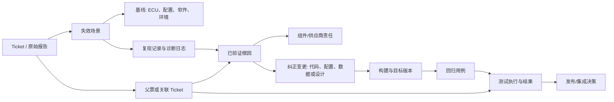

# IDCEVO Phase 09 研发闭环质量与缺陷学习研究

> **定位：** 面向项目质量、系统/软件/集成研发、功能负责人、测试负责人和供应商接口人的工程分析；不作为售后运营或客户投诉处理方案。

## 研发结论

从研发视角，当前 Phase 09 数据最大的价值不是找出多少问题可能进入现场，而是量化一个更根本的问题：**研发是否能够用可追溯证据证明某个问题已经被理解、被纠正、被验证并被交付。**

工作簿显示的主矛盾是“关闭状态”与“工程闭环”脱钩。Phase 09 可以代表工单流程结束，却不天然证明根因已经确认、修复已进入可识别构建、回归测试已经通过，或同类问题不会在后续集成周期复发。

因此，研发侧应将管理对象从单张 Ticket 和关闭数量，升级为以下工程链路：

$$
\text{失效场景} \rightarrow \text{可复现性} \rightarrow \text{根因} \rightarrow \text{纠正变更} \rightarrow \text{验证} \rightarrow \text{版本交付} \rightarrow \text{复发监控}
$$

Phase 09 只能是这条链路的最后一个结果字段，不能替代链路本身。

## 数据边界与可信度

本研究以 [2026-09-07 FinalProject 工作簿](../exports/idcevo_phase09/IDCEVO_Phase09_Closure_Risk_20260907_FinalProject_LLM_Complete.xlsx) 的 2026-09-07 数据快照为事实基础，并使用 [2026-09-08 RCA/聚类增强工作簿](../exports/idcevo_phase09/IDCEVO_Phase09_Closure_Risk_20260908_FinalProject_LLM_Complete.xlsx) 中的逐条 RCA、重复聚类和证据完整度字段进行研发分析。

范围是最终项目 `tproject=IDCEVO`、当前处于 Phase 09、包含 China-specific 功能且排除 CoC finder-team 的 18,000 条记录。9 月 8 日增强版没有改变这 18,000 条母体和 931 条优先复核集合；它增加了 RCA 和聚类辅助信息，并将 100 条记录从严格“无证据直关”重新归为“关闭证据不完整”。这 100 条仍是研发数据质量债务，不应因标签变化而从分析范围消失。

### 现有数据可以与不可以证明什么

| 证据层 | 现有数据可支持的判断 | 不能单独支持的判断 |
| --- | --- | --- |
| Phase、关闭历史、关闭原因 | 生命周期路径、直关、重开、理由缺失 | 技术问题已经修复 |
| Ticket 描述、评论、LLM/RCA 提取 | 候选症状、候选根因、候选规避和待核实问题 | 根因已被工程评审确认 |
| Target、计划窗口、Reprel、商业日期 | 有计划或版本相关活动 | 代码/配置已合入、构建已发布、修复已验证 |
| 父票和重复关系 | 候选依赖关系和需追溯对象 | 子票已随父票解决，除非范围和验证均匹配 |
| 关键词聚类和重复标题 | 候选失效模式、复发研究起点 | 同一技术根因或可自动合并 Ticket |

当前快照尚未将源代码变更、配置变更、供应商纠正报告、CI 构建、测试用例、测试执行、软件发布清单和需求基线连接到同一条证据链。因此它能可靠地识别**研发闭环债务**和**研究优先级**，但不能凭自身证明修复有效性。

## 当前研发质量画像

### 闭环债务规模

| 指标 | 数量 | 研发解释 |
| --- | ---: | --- |
| 当前 Phase 09 分析母体 | 18,000 | 闭环质量的统计母体 |
| 严格无审计依据直关 | 4,270 | 没有可接受关闭或后续/修复证据的重点债务 |
| 关闭证据不完整监控项 | 100 | 规则口径收敛后仍需人工确认的债务 |
| 优先工程复核 | 931 | 高风险/高不确定性的重叠队列 |
| QGate 治理严重 | 293 | 需要研发管理层逐条处置的高影响队列 |
| 历史 `01 -> 09` 直跳 | 17,697 | 98.3%，说明该路径适合做审计触发器，不能单独当作严重度判定 |
| 历史发生过 Phase 09 后重开 | 430 | 已证明部分关闭结论在后续被否定；可用作关闭质量的反向检验 |

上述队列存在重叠，不能相加。尤其是 293 条治理严重记录中，158 条位于“优先工程复核”、135 条位于“决策-证据冲突”；两者合计正好覆盖这 293 条严重记录。

### 严格直关的工程证据缺口

在 4,270 条严格无审计依据直关中：

| 指标 | 数量 | 比例 |
| --- | ---: | ---: |
| 未记录关闭原因 | 2,308 | 54.1% |
| RCA 技术证据完整度不高于 `2/4` | 3,977 | 93.1% |
| 可从 RCA 字段提取根因候选文本 | 1,444 | 33.8% |
| 出现测试/验证信号 | 447 | 10.5% |
| 同时有根因候选和测试/验证信号 | 210 | 4.9% |
| 出现明确复现成功信号 | 168 | 3.9% |
| 历史上 Phase 09 后重开 | 113 | 2.6% |
| 具有版本、计划、关联解决或重新进入 Phase 06 的交付锚点 | 0 | 0.0% |

这里的“根因候选”“测试/验证信号”和“复现成功信号”来自 12_逐条RCA分析页的结构化提取，不是已经审批的工程事实。它们的价值在于快速找出需要工程师验证的证据，而不是自动形成关闭结论。

### 优先工程复核与严重项

| 指标 | 优先工程复核 931 条 | 治理严重 293 条 |
| --- | ---: | ---: |
| RCA 完整度不高于 `2/4` | 841 (90.3%) | 267 (91.1%) |
| 有根因候选文本 | 719 | 159 |
| 有测试/验证信号 | 209 | 55 |
| 同时有根因和测试/验证信号 | 182 | 38 |
| 有交付锚点 | 30 | 0 |
| 同时具备根因、验证与交付锚点 | 8 | 0 |
| 历史上 Phase 09 后重开 | 53 | 10 |

研发管理的首个动作应是对 293 条治理严重项完成技术处置分类，而不是立即把它们都当成同一类“高风险缺陷”：确认是否已经有有效父票、是否属于设计/实现/集成/配置/测试缺口、是否存在未记录的修复构建，以及是否应转入专业安全、法规或系统工程流程。

### “有跟进”不等于“已交付”

9,206 条记录被当前规则归为 `Follow-up / remediation recorded`。这是有用的发现，但研发侧必须拆开“计划活动”和“可验证交付”：

| 可观察到的字段 | 记录数 | 说明 |
| --- | ---: | --- |
| Reprel change / shift | 8,412 | 计划发生变化；不等价于修复已实现 |
| Target version | 2,539 | 存在版本记录，仍需关联实际构建和验证 |
| 计划窗口 | 590 | 有排期线索，仍非发布证据 |
| 商业解决日期 | 98 | 时间承诺，不等价于技术验证 |
| 父票在当前 Phase 09 后达到 Phase 06 | 425 | 候选关联解决，必须验证适用范围 |
| 重新进入 Phase 06 | 1,974 | 流程上重新解决的强信号，仍需测试和版本证据 |
| 仅有 Reprel，且没有交付锚点或修复计划 | 4,560 | 49.5%，应标记为“计划活动”，不能称为“已解决” |
| 同时具有根因、验证信号和交付锚点 | 503 | 仅 5.5%，还需人工核验原始工程工件 |

各行不是互斥集合，不能相加。这里的“交付锚点”是 Target、计划窗口、商业日期、关联父票在当前 Phase 09 后进入 Phase 06 或该 Ticket 重新进入 Phase 06 中至少一项；它只是最低限度的追溯起点，仍不能替代构建 ID、提交记录和测试执行结果。

### 关闭原因暴露出的不同研发问题

严格直关队列应按关闭原因进入不同的工程工作流，而不是统一要求补写一段 RCA：

| 关闭原因 | 数量 | 完整度不高于 `2/4` | 研发上的真实问题 | 必须补齐的工件 |
| --- | ---: | ---: | --- | --- |
| Not recorded | 2,308 | 2,191 | 连关闭语义都不完整，无法开始有效分析 | 关闭类型、责任方、最小技术结论 |
| Child (Duplicate) | 755 | 654 | 父票依赖与范围匹配未被证明 | 父票 ID、共同失效机理、版本/ECU/车型范围、父票验证 |
| Management decision | 678 | 654 | 管理决定代替了技术交付结论 | 风险接受边界、到期日、替代措施、重新评审条件 |
| Expected behaviour | 125 | 121 | 需求/规格、实现和测试预期没有形成闭环 | 需求条款、设计说明、正确性测试和评审结论 |
| Additional Information necessary | 111 | 100 | 可观测性或诊断合同不足 | 最小日志包、trace 标识、采集条件和复现责任人 |
| Not reproducible | 107 | 93 | 复现环境、版本、配置或诊断数据未被控制 | 最小复现协议、环境快照、日志、最新构建复测 |
| Function not implemented/testable yet | 82 | 80 | 功能成熟度、需求/设计或测试就绪度不足 | 功能可用边界、交付版本、测试入口和退出条件 |

## 研发侧真正应分析的单位

### 区分 Ticket、失效场景与缺陷族

一张 Ticket 不是天然的分析单位。研发应同时维护三个不同层次：

| 单位 | 定义 | 作用 |
| --- | --- | --- |
| Ticket | 一次报告和生命周期记录 | 保存原始证据、责任流转和审计轨迹 |
| 失效场景 | 在确定前提、配置、版本和动作下可观察的异常行为 | 复现、回归和诊断的最小单位 |
| 缺陷族 | 相同技术失效机理造成的一组失效场景 | 根因纠正、架构改进和重复问题消减的单位 |

“标题相似”或“共享父票”最多是缺陷族候选。要确认同一缺陷族，至少应同时验证：功能/组件、ECU 或软件边界、触发条件、失效机理、修复适用范围和测试结果。这样才能避免把相似的 HMI 症状或同一供应商标签误合并。

### 研发证据图谱

建议以 `failure_mode_id` 或 `defect_family_id` 为中心建立可审计图谱。每条边必须带来源链接、时间、责任人和证据等级。

当前工作簿已能提供 `Ticket -> 失效场景候选`、部分 `Ticket -> 父票`、部分 `Ticket -> 版本计划` 和部分 `Ticket -> RCA 候选`。缺失的是 `根因 -> 纠正变更 -> 构建 -> 测试执行 -> 发布决策` 这条决定研发闭环有效性的主链。

## 建议的工程证据阶梯

将每个缺陷族而非每张 Ticket 评估为以下层级。只有相应层级的原始工件齐备，才允许在报告中使用“已确认”“已验证”“已交付”等词。

| 层级 | 工程问题 | 最小可审计证据 | 不能由什么替代 |
| --- | --- | --- | --- |
| E0：报告已固化 | 现象是否被准确记录？ | 预期/实际行为、前提、软件、配置、日志索引 | 标题或一句评论 |
| E1：可复现性受控 | 是否可在明确基线复现或可靠排除？ | 测试步骤、环境快照、构建 ID、复现结果、trace | “无法复现”的结论句 |
| E2：根因已验证 | 什么机制导致失效？ | 因果证据、代码/配置/接口分析、评审结论 | LLM 摘要、猜测或相似 Ticket |
| E3：纠正已实施 | 修改了什么，为什么能消除原因？ | commit/CR、配置变更、供应商纠正报告、影响分析 | Reprel 或 Target 版本 |
| E4：纠正已验证 | 修复是否在原场景和边界场景通过？ | 回归用例、自动化/车辆执行、结果、日志 | “Fix mentioned” 文本信号 |
| E5：交付已追溯 | 哪个构建、哪些目标配置包含修复？ | 构建 ID、发布清单、适用范围、变更追溯 | 商业日期或计划窗口 |
| E6：有效性已观察 | 同类失效是否在后续周期消失？ | 后续集成/回归趋势、未重开证据、缺陷族复发审查 | 单次测试通过 |

### Phase 09 的研发分类

不要再用一个笼统的“关闭”覆盖所有情况。建议为 Phase 09 增加独立的工程结论类别：

| 工程结论类别 | 最低证据阶梯 | 允许的关闭语义 |
| --- | --- | --- |
| Resolved and delivered | E0-E5 | 根因、纠正、验证和交付均可追溯 |
| Verified non-defect | E0-E1 + 规格/设计证据 | 行为与需求一致，且适用边界明确 |
| Valid duplicate | E0-E1 + 父票 E4-E5 | 失效机理与适用范围匹配已验证的父票 |
| Approved technical deferral | E0-E2 + 风险接受 | 未解决，但风险、措施、到期日和重审条件受控 |
| Evidence insufficient | E0 或 E1 不完整 | 不能被记为“已解决”；保留为工程债务或待补证据项 |

这套分类的重点是让“流程结束”和“技术解决”分别可见。项目可以有合规的风险接受或非缺陷关闭，但不能把它们混入已验证修复的成功率。

## 研发优先级与工作流

### 不建议使用单一线性风险分

风险分便于排序，但会把安全/法规、交付不确定性、复发和数据债务混为一个数字。研发侧更可靠的是门控分层：先看不可接受影响，再看工程闭环缺口，最后看频率和规模。

| 队列 | 进入条件 | 当前规模 | 研发目标 | 建议节奏 |
| --- | --- | ---: | --- | --- |
| P0：治理严重技术处置 | 现有 QGate 治理严重标记 | 293 | 明确技术结论、范围、责任和是否进入专业升级流程 | 每日 |
| P1：高不确定性闭环 | 优先工程复核、重开、无修复声明、父票未验证或高风险关闭理由 | 931 | 在 E1-E5 中明确最早缺失层级和补证据计划 | 每周两次 |
| P2：重复失效模式 | 经工程确认的候选簇，优先簇规模至少 10 | 104 个候选簇，覆盖 1,660 条 C/D Ticket | 消除共同机理、补回归资产、减少重复报告 | 每周专题 |
| P3：关闭语义与证据债务 | 严格直关、关闭理由缺失或低证据完整度 | 4,270 条严格直关 + 100 条监控项 | 按关闭原因和组件批量补齐最小事实 | 双周批量治理 |

P0 不等同于自动安全事件。若 P0 中出现安全、法规、车辆不可用或功能安全迹象，应按已有的专业流程升级；本报告仅说明研发证据不足和需要技术处置，不能替代专业安全分析。

### 首批工程专题的入口

功能标签适合确定工作坊入口，不应被误认为根因分类。下表将严重、优先复核、直关量和低证据量共同考虑：

| 功能入口 | 严重 | 优先复核 | 严格直关 | RCA 完整度不高于 `2/4` | 建议的研发专题 |
| --- | ---: | ---: | ---: | ---: | --- |
| Navigation CN | 18 | 18 | 216 | 1,147 | 地图/定位/路线/版本基线与回归矩阵 |
| Application Navigation China HK | 14 | 8 | 148 | 257 | 映射到组件、地图内容、版本和崩溃/降级策略 |
| MMI | 11 | 24 | 84 | 210 | HMI 状态机、启动/恢复路径与 UI 回归资产 |
| CarFunctions | 7 | 86 | 98 | 611 | 配置/ECU/功能边界及父票依赖清理 |
| Audio Infrastructure | 0 | 58 | 108 | 775 | 音频路由、源切换、连接状态与系统集成测试 |
| Entertainment | 0 | 46 | 124 | 709 | 应用、内容、媒体源和版本组合的失效场景 |
| Speech CN | 5 | 33 | 235 | 1,165 | 语料、意图、云/本地链路、语言包和恢复策略 |
| ENT_and_CON CN | 6 | 15 | 148 | 934 | 手机/协议/应用版本与车机软件的兼容性矩阵 |

表中“0”只表示当前工作簿中没有命中 QGate 治理严重标记，不表示该领域没有技术风险。专题开始后应继续拆到组件、ECU、供应商、软件分支和失效机理层级。

## 缺陷族的标准研发分析方法

每个 P0/P1 或已确认 P2 缺陷族都应用同一套分析协议。它比补写 Ticket 评论更有价值，因为输出直接可进入设计、集成、测试和发布决策。

### 1. 固化问题与基线

记录唯一的 `failure_scenario_id`、实际/预期行为、触发动作、恢复方式、软件/I-Step、ECU、配置、市场/语言、环境、日志版本和首次/最后一次观察时间。没有基线的描述不能进入“不可复现”结论。

### 2. 受控复现与诊断

把“测试步骤已写”与“问题已复现”分开。当前严格直关中有 3,988 条带“复现步骤已记录”信号，但只有 168 条带“已复现”信号，103 条明确“不可复现”。这提示项目应建立统一的复现记录，而非仅要求填写步骤：

- 基线是否与原始报告一致；
- 复现次数、成功次数和失败次数；
- 是否捕获完整的 trace/log/抓包；
- 最新目标构建上的复测结果；
- 不可复现时缺失的是环境、数据、时序、硬件还是可观测性。

### 3. 根因与注入阶段

根因分类建议使用受控枚举而非自由文本，至少包括：需求/规格、系统设计、软件实现、集成接口、配置/编码、数据/内容、时序/资源、环境依赖、供应商交付、测试设计和诊断可观测性。

每项根因还应有：因果证据、受影响组件、注入阶段、逃逸阶段、责任边界、置信级别和反证。这样可以避免“根因”实际只是现象复述、供应商转交或泛化描述。

### 4. 纠正与影响分析

把修复关联到可版本化工件：代码提交、配置变更、需求/设计变更、供应商补丁、特征开关或数据包。每项变更必须说明：

- 修复针对的因果机制；
- 影响的功能、ECU、车型、配置与软件分支；
- 向前/向后移植策略；
- 新风险与回归范围；
- 不能修复时的技术风险接受边界和再次评审条件。

### 5. 验证、发布与有效性

验证必须区分原始场景回归、边界/反例回归、集成验证和目标构建验证。发布必须保留构建 ID 和适用范围。随后按后续集成周期审查重开、同族新 Ticket 和重复候选，作为 E6 有效性证据。

## 必须补齐的数据连接

研发质量分析不需要先接入售后系统，但必须优先连通研发自己的事实来源。

| 数据源 | 需要连接的关键字段 | 解决的问题 |
| --- | --- | --- |
| Octane/QGate 缺陷与历史 | Ticket、Phase、理由、父票、功能、ECU、软件、责任人 | 生命周期、关闭语义与责任追溯 |
| 需求/架构/接口工件 | requirement ID、设计决定、接口版本 | 验证“预期行为”和设计类关闭 |
| 源码与配置管理 | commit/CR、分支、模块、变更原因 | 证明纠正是否真实实施 |
| CI/CD 与构建清单 | build ID、软件/I-Step、组件版本、发布包 | 证明修复在哪个构建可用 |
| 测试管理与执行 | 测试用例、运行、日志、结果、覆盖范围 | 证明原场景与回归场景已验证 |
| 供应商问题管理 | supplier case、8D/纠正措施、交付版本 | 防止“已转供应商”成为无主关闭 |
| 集成/质量评审记录 | 风险接受、偏差、到期日、批准人 | 区分已解决、已接受和证据不足 |

连接后的最小关系应为：

$$
\text{Ticket} \rightarrow \text{根因} \rightarrow \text{变更} \rightarrow \text{构建} \rightarrow \text{测试执行} \rightarrow \text{发布决定}
$$

只要其中任何一段断开，就应在分析中明确显示为“待补证据”，而不是以模糊的“Follow-up”掩盖。

## 应持续监控的研发指标

所有指标应按组件/功能、软件分支、供应商和发布周期分解，且分母必须明确。

| 指标 | 推荐公式 | 说明 |
| --- | --- | --- |
| 工程有效关闭率 | `E4-E5 已具备的关闭缺陷族 / 当期关闭缺陷族` | 与流程关闭率分开报告 |
| 根因验证率 | `有因果证据和评审的根因 / 需 RCA 的缺陷族` | 不以自由文本出现次数计数 |
| 纠正可追溯率 | `关联 commit/CR/配置或供应商纠正工件的已解决项 / 已解决项` | 防止“Fix mentioned”替代变更事实 |
| 验证可追溯率 | `有用例、运行、结果和日志索引的纠正项 / 已纠正项` | 关注执行证据而非测试名称 |
| 发布可追溯率 | `有目标构建和适用范围的已验证项 / 已验证项` | 识别修复没有进入目标版本的风险 |
| 重复关闭完整率 | `范围匹配且父票 E4-E5 完整的重复关闭 / 重复关闭` | 取代“父票存在即可关闭” |
| Phase 09 后重开率 | `后续重开缺陷族 / 已关闭缺陷族` | 作为关闭质量的滞后指标 |
| 复现成功率 | `在受控基线成功复现的场景 / 发起复现的场景` | 分析可观测性和环境控制能力 |
| 测试逃逸分布 | 按注入阶段、逃逸阶段和测试层级统计 | 指导测试资产和架构改进 |

对于发布周期 $r$，可将工程有效关闭率定义为：

$$
\operatorname{EffectiveClosureRate}(r) =
\frac{\#\{f \mid f \text{ 在 } r \text{ 中具备 E4 与 E5 证据}\}}
{\#\{f \mid f \text{ 在 } r \text{ 中被标记关闭}\}}
$$

其中 $f$ 是缺陷族而不是 Ticket。这样同一失效机理产生的多张重复 Ticket 不会虚增“关闭成绩”。

## 自动化与人工判断的边界

LLM、规则和聚类在研发分析中非常有用，但它们应承担“发现和整理”职责，而不是“裁决和关闭”职责。

| 自动化适合做的事 | 必须由工程责任人确认的事 |
| --- | --- |
| 从评论/历史提取候选根因、版本、父票、日志词和修复线索 | 根因是否成立、适用范围是否一致 |
| 检测缺失的 E0-E5 工件 | 纠正变更是否足以消除因果机制 |
| 产生相似 Ticket 和失效模式候选簇 | 是否属于同一缺陷族、是否可合并 |
| 自动生成 RCA 证据卡初稿和测试建议 | 测试覆盖是否有效、是否允许 Phase 09 |
| 计算指标和超时提醒 | 风险接受、发布和安全升级决定 |

每一条自动提取结果都应保留原始 Ticket 评论、历史事件、附件或工件链接。没有来源的总结不可进入关闭证据卡。

## 建议的研发落地路径

| 时间 | 研发动作 | 可验收结果 |
| --- | --- | --- |
| 第 0-3 天 | 冻结 E0-E5 字段定义；对 293 条严重项指定技术负责人和下一次评审时间 | 每项有工程结论类别或明确缺失层级 |
| 第 1-2 周 | 对 931 条优先项进行 E1-E5 缺口分流；优先核验 713 条 `Child (Duplicate)` | 父票范围匹配、版本和验证状态可追溯；不匹配项回到独立缺陷族 |
| 第 2-4 周 | 将 4,270 条直关按关闭原因、组件和失效模式批量处理 | 2,308 条理由缺失项被补齐最小关闭语义；证据不足项不再混入已解决统计 |
| 第 3-6 周 | 连通变更、构建和测试执行数据，形成工程证据图谱 | `Ticket -> 变更 -> 构建 -> 测试` 的可查询链路 |
| 一个发布周期 | 将已确认 P2 缺陷族转为回归资产和发布门禁 | 原始场景、边界场景和目标构建均有执行证据 |
| 一个季度 | 按重开、复发、逃逸和有效关闭率复盘关闭规则 | 关闭质量和缺陷学习取代单纯关闭数量成为主指标 |

## 与 Automotive SPICE 的关系

[Automotive SPICE 4.0](https://vda-qmc.de/en/automotive-spice/) 的公开说明强调过程结果、清晰责任、计划与监控、系统化归档和质量保证，并将过程能力与持续改进联系起来。本报告的 E0-E6 证据阶梯、可追溯图谱、责任分流和统计反馈，旨在把这些原则落实到项目的缺陷解决和质量学习活动中。

这不是对 Automotive SPICE 的符合性声明，也不能替代项目既有的质量体系、功能安全、网络安全、法规或供应商管理流程。它提供的是一套可以利用现有 Phase 09 数据立刻启动、并能逐步接入研发工件的分析框架。

## 最终建议

不要把当前工作簿直接转成售后清单。先把它作为研发“闭环质量雷达”：识别哪些问题没有技术结论、哪些修复没有构建与测试证据、哪些重复关系不可信、哪些失效模式正在反复出现。

研发成功的定义不应是更多 Ticket 到达 Phase 09，而应是更多缺陷族能够形成从失效场景到发布验证的完整证据链，并把已学到的失效模式沉淀为需求澄清、架构约束、诊断能力和回归测试资产。
