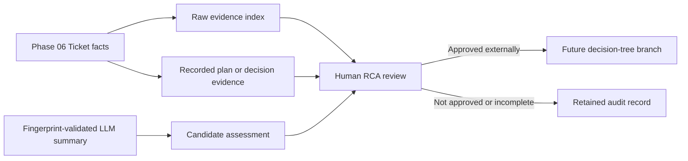

# Phase 06 RCA Candidate Library

## Purpose

The Phase 06 RCA Candidate Library is a review artifact, not an automatic
after-sales decision tree. It makes potential symptom-to-cause-to-remedy
patterns traceable before any human-approved pattern is allowed to enter a
future decision tree.



The generated library never promotes a candidate automatically. Every row has
`approved_tree_rule = false` and `tree_rule_status = human_review_required`.

## Source Contract

The builder accepts a Phase 06 workbook with `05_全部明细` and requires these
Ticket-level fields:

- `Ticket ID`, `功能`, `Solution Cluster`, `Defect Category`, `Assigned ECU`, and `Software Version`.
- `关闭处置`, `Ticket 标题`, `问题描述摘录`, and `证据原文索引`.
- `修复计划证据`, `决策证据`, and `无修复证据`.

The input cache does not contain a `source` field. The LLM assessment is therefore
accepted only when its summary-side `source` is `llm`, and its `ticket_id`,
`input_fingerprint`, and `input_version` exactly match the local Phase 06 input
cache. Duplicate input Ticket IDs are ambiguous and are excluded.
The accepted summary must contain all five generated sections exactly once and in
the generated order:

```text
根因：
修复质量：
Reject/关闭原因：
后续闭环：
风险判断与逃逸回顾：
```

This validates provenance of the generated summary. It does not validate that
the LLM's causal statement is technically correct. The Ticket's raw evidence
index and recorded repair or decision evidence remain required review inputs.

## Review States

`P1` means an LLM causal-mechanism signal, raw repair-plan or decision evidence,
and a raw evidence reference are all present, with no detected root-cause
uncertainty or `no-fix` evidence. It is a higher-priority human review candidate,
not an approved cause or remedy.

`P2` means a causal-mechanism signal or recorded remedy evidence exists but the
other evidence is missing, uncertain, or conflicting. `Not shortlisted` means
neither signal exists; it remains in the all-Ticket audit sheet.

The lexical signals are used only to order review work. They never make a
vehicle diagnosis, identify a verified root cause, prescribe a repair, or claim
that a validation passed.

`Resolution evidence complete` is also not a technical approval state. In the
Phase 06 source it is a lifecycle and delivery-evidence assessment. It does not
by itself prove a causal mechanism, a specific remedy, or validation coverage.

## Generated Artifacts

- `IDCEVO_Phase06_RCA_Candidate_Library_V1.xlsx`
  - `00_Overview`: validation and queue counts, including zero automatic rules.
  - `01_RCA_Review_Queue`: P1 and P2 candidates with LLM assessment, raw remedy evidence, and evidence index.
  - `02_All_Ticket_Audit`: every source Ticket and its eligibility signals.
  - `03_Function_Readiness`: per-function candidate and evidence coverage.
  - `04_Data_Dictionary`: generation policy and field definitions.
- `IDCEVO_Phase06_RCA_Candidate_Library_V1.json`: machine-readable audit and policy payload.
- `IDCEVO_Phase06_RCA_Candidate_Library_V1.html`: searchable review queue and promotion path. It is intentionally not a diagnostic tree.

## Promotion Requirement

A future decision-tree branch needs a documented human review that links:

1. Customer symptom and trigger facts from Ticket evidence.
2. A technically specific causal mechanism backed by the raw description,
   comments, history, or approved technical analysis.
3. The actual recorded remedy or workaround and its applicability conditions.
4. Positive verification evidence, including test scope or an equivalent
   approval record.
5. The source Ticket/evidence references and the reviewer decision.

Until those five elements are present, the library is evidence for review, not
an executable or prescriptive after-sales decision-tree route.
