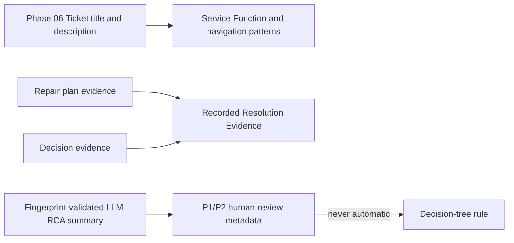

# Phase 06 Symptom-to-Resolution Evidence Trees

## Purpose

This catalog reuses the navigation form of the Phase 09 V12
Symptom-to-Solution Trees for Phase 06-concluded Tickets:

```text
Service Function
  -> Issue Group
  -> Symptom Pattern
  -> Trigger Pattern
  -> Recorded Resolution Evidence
```

It is a data navigation catalog, not an executable vehicle diagnostic tree.

## Difference from Phase 09 V12

Phase 09 V12 has normalized customer Scenario fields and a Ticket `Recovery
Action` field. Its terminal is `Ticket Solution`, which is copied from recorded
recovery text and may still be a workaround.

Phase 06 uses `Phase06full.xlsx` Ticket facts. It has Ticket title and problem
description excerpts for navigation, but no normalized customer symptom/trigger
or recovery-action field. The Phase 06 terminal is therefore named `Recorded
Resolution Evidence` and copies only an existing `Repair Plan Evidence` or
`Decision Evidence` excerpt. It is not called `Known Solution` or `Verified
Repair`.

When neither source evidence field is usable, the terminal remains empty in the
machine-readable data and is displayed as `No recorded resolution evidence` in
the SVG. This is an evidence-gap label, not a repair or escalation instruction.



## RCA Boundary

The catalog imports P1/P2 counts from the Phase 06 RCA Candidate Library only as
human-review metadata. It does not place LLM root-cause or fix-quality text into
tree nodes, and every generated node has `approved_tree_rule = false`.

The required sequence for a future approved branch remains:

1. Review the raw Ticket description, comments, and history referenced by the evidence index.
2. Confirm a technically specific causal mechanism rather than an LLM candidate statement.
3. Confirm the recorded remedy and its applicability conditions.
4. Confirm positive verification evidence and scope.
5. Record an external human approval before promoting a pattern into a service decision tree.

## Source and Output Contract

The builder reads:

- `Phase06full.xlsx`, sheet `05_全部明细`, for Ticket title, description excerpt, function context, raw evidence index, repair-plan evidence, decision evidence, and no-fix evidence.
- The local `phase06_inputs_v1.jsonl` and `phase06_summaries_v1_pro.jsonl` cache for P1/P2 metadata. A summary must have `source=llm` and exactly match an unambiguous input Ticket ID, fingerprint, and version.

It writes a separate Phase 06 V1 artifact set. It does not overwrite the Phase
09 V12 files or embed Phase 09 reference-tree IDs/assets. Only the common
navigation structure is reused.

- `IDCEVO_Phase06_Symptom_to_Resolution_Evidence_Trees_V1.xlsx`
- `IDCEVO_Phase06_Symptom_to_Resolution_Evidence_Trees_V1_Decision_Tree_Knowledge_Base.json`
- `IDCEVO_Phase06_Symptom_to_Resolution_Evidence_Trees_V1_Decision_Tree_Catalog.html`

The workbook contains one row per Phase 06 Ticket, the P1/P2 review queue,
Service Function coverage, the V12-shaped tree catalog, tree nodes with source
Ticket IDs and review counts, and the source contract.
