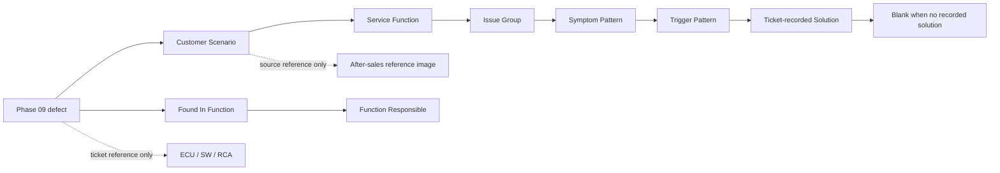

# Phase 09 Symptom-to-Solution After-Sales Knowledge Base

## Purpose

The after-sales model has one primary navigation dimension: `Service Function`.
It selects the decision-tree entry. `Found In Function` and `Function Responsible`
remain a separate one-to-many R&D attribution mapping and never determine the
customer's entry tree.



## Source Assets

- 39 after-sales PNG diagrams were catalogued from `C:\Users\q446328\Downloads\decisiontree`.
- Lossless WebP copies are stored under [exports/idcevo_phase09/decision_tree_sources/lossless_webp](../exports/idcevo_phase09/decision_tree_sources/lossless_webp). They preserve the original pixels and reduce total storage from 49.06 MB to 9.48 MB.
- The WebP copies are for browsing and linking. They do not make OCR easier because decoded pixel counts are unchanged.
- A full, original-resolution OCR run is not used as the classification source: 39 diagrams total about 716 MP, and 15 individual files exceed 20 MP. OCR is only needed in targeted original-resolution crops when a source-image branch needs human verification.

## Reference Assets and V12 Problem Path

| Service domain | Reference trees | Common diagnostic pattern |
| --- | --- | --- |
| ConnectedDrive, entitlement, and connectivity | CDUnspecified, legacy/GEN2 connectivity, LSC, Mapping/CD Activation, CBS, BON Weather, PERS.eSIM, Account | Vehicle presence/online state, SA code or capability, booking/contract, provisioning, vehicle-data synchronization, specialist route |
| Remote and mobile services | Remote Service, MYBMW APP, R360, MyTrips, Send2Car | App/account binding, backend/API state, connectivity, vehicle wake-up, data freshness, remote-service owner |
| Navigation, location, and driver assistance | Navigation, MapUp, RTTI, SLI, ConnectedDrive-ADAS, IndoorParking, Digital Tire | Vehicle capability, map/location/sensor input, navigation or ADAS symptom branch, specialist route |
| In-car entertainment, apps, and phone projection | CarPlay, Entertainment, QQ Music/Himalaya, AM/SR, ConnectedDrive Store, FOD V1/V2 | App/device compatibility, entitlement or store state, connection/playback/content branch, provider/platform route |
| Assistance and emergency calls | ACall, BCall, eCall | Vehicle online state, SA code, service booking or enablement, call-path evidence, emergency-service escalation |
| Charging and energy | BAT Monitoring, CCM, eMobility & Charging | Vehicle/app synchronization, charging eligibility or contract, charging data, service-channel checks |
| Personalization, identity, and digital key | PIA, Digital Key | Profile/account/entitlement, pairing, synchronization, privacy and vehicle binding |
| Voice and camera/recording | IPA, Drive Recorder | Feature eligibility, version/configuration, diagnostic evidence, feature-team escalation |

The supplied images are catalogued reference assets. Their individual nodes and
routes are not copied into the generated tree and are not used to classify
Tickets. V12 deliberately does **not** turn their repeated Ticket-field workflow
into a mandatory `YES` / `NO` chain. Checking whether a historical Ticket contains
preconditions, reproduction facts, ECU/SW values, or RCA text does not diagnose a
live vehicle and does not advance an after-sales repair.

Instead, every V12 path is a customer-problem navigation path:

```text
Service Function
  -> Issue Group
  -> Symptom Pattern
  -> Trigger Pattern
  -> Ticket Solution
```

1. `Issue Group` is the first customer-problem split, grouped from the observed `Problem Type`. Each Service Function keeps its most frequent eight groups and retains all lower-frequency groups under a counted `Other observed issue groups` branch.
2. `Symptom Pattern` narrows the customer-visible behaviour from recorded `Customer Symptom` and `Observed Behaviour` values.
3. `Trigger Pattern` narrows when or during which customer action the symptom occurs, using recorded `Trigger Condition` values.
4. `Ticket Solution` contains only non-empty Recovery Action text already recorded in a supporting Ticket. It can be a workaround or temporary recovery; it is not a root-cause finding, an approved repair instruction, or a newly inferred solution. When no such text exists, the solution content is blank and its status is `no_ticket_solution_recorded`.

`Prerequisites`, reproduction details, ECU/SW, and RCA remain traceable in the
underlying Ticket evidence where present, but are not main-tree stages. They can
be consulted by an engineer after the customer problem path has identified a
candidate scenario; they must not be mistaken for a customer-facing answer.

V12 is a data-derived catalogue of historical problem paths, not a claim that all
possible failures of a Service Function have been exhaustively diagnosed. A true
vehicle-condition decision tree needs an after-sales-approved question, a verified
branch criterion, and a verified terminal action for each branch.

## Governing Classification Rules

### Service Function

`Service Function` is the sole after-sales navigation and tree-root dimension.
The catalog includes supplied after-sales functions and R&D-derived candidates
where Phase 09 shows a major domain without a supplied source tree.

The V12 Excel intentionally hides `Service Function ID`, `Tree ID`, and
`Reference Tree ID`. They are implementation identifiers needed only by the
machine-readable JSON and interactive HTML to preserve relationships. In Excel,
`Service Function` identifies the customer entry, while `Found In Function` and
`Function Responsible` provide the readable R&D attribution.

CarPlay and HiCar are separate Service Functions and separate data trees.
Specific `CarPlay` / `Apple CarPlay` evidence routes to `DT-CARPLAY`; specific
`HiCar` / `Huawei HiCar` evidence routes to `DT-HICAR`. A generic
`CarPlay / HiCar` label without more specific Ticket evidence routes to
`CDUnspecified` rather than merging the two product paths.

### Found In Function and Function Responsible

`Found In Function` is the original Octane R&D function in which the defect was
found. A Scenario can contain more than one such function and owner because its
member Tickets may cross technical boundaries. The normalized
`Scenario -> Found In Function -> Function Responsible` mapping preserves that
relationship without adding a Family layer to the service workflow.

### Key Cross-Domain Examples

| Example | After-sales service entry | Found In Function / owner role |
| --- | --- | --- |
| Third-party gaming | Entertainment | Keeps the game, Store, HMI, or connectivity source function and responsible owner for R&D follow-up. |
| CarPlay audio failure | CarPlay | Keeps `Audio Infrastructure` or audio-routing attribution while customer navigation stays in CarPlay. |
| HiCar audio failure | HiCar | Keeps the same R&D attribution mechanism while customer navigation stays in the separate HiCar tree. |
| `AD_Apps` navigation CCP drift | Navigation | Keeps `AD_Apps` attribution while the customer symptom enters the Navigation tree. |
| Accident Call / xCall | ACall | Keeps the specific call/service owner without merging ACall, BCall, and eCall customer entries. |
| Remote / My BMW / R360 | Remote Services | Keeps app, wake-up, remote command, or remote-view attribution and owner. |

## Generated Artifacts

- [exports/idcevo_phase09/IDCEVO_Phase09_Field_Escape_Scenario_Library_V12_Symptom_to_Solution_Trees.xlsx](../exports/idcevo_phase09/IDCEVO_Phase09_Field_Escape_Scenario_Library_V12_Symptom_to_Solution_Trees.xlsx)
  - `01_Scenario_Library`: starts with Service Function, Scenario ID, Problem Type, Customer Symptom, and Trigger Condition.
  - `02_Scenario_FoundIn_Function`: one row per Scenario/R&D-function/owner attribution.
  - `04_Decision_Tree_Catalog`: one symptom-to-solution problem path per Service Function.
  - `05_Decision_Tree_Nodes`: parent-linked issue, symptom, trigger, and Ticket Solution nodes with source Scenario/Ticket counts and an explicit solution status.
  - `10_Tree_Growth_Candidates`: Service Function and Problem Type aggregates with data-backed symptom, trigger, function, owner, and Ticket-solution samples.
- [exports/idcevo_phase09/IDCEVO_Phase09_Field_Escape_Scenario_Library_V12_Symptom_to_Solution_Trees_Decision_Tree_Knowledge_Base.json](../exports/idcevo_phase09/IDCEVO_Phase09_Field_Escape_Scenario_Library_V12_Symptom_to_Solution_Trees_Decision_Tree_Knowledge_Base.json)
  - Lightweight machine-readable symptom-to-solution model. It retains internal IDs needed for relationships and records whether a terminal Ticket Solution has source text or is intentionally blank.
- [exports/idcevo_phase09/IDCEVO_Phase09_Field_Escape_Scenario_Library_V12_Symptom_to_Solution_Trees_Decision_Tree_Catalog.html](../exports/idcevo_phase09/IDCEVO_Phase09_Field_Escape_Scenario_Library_V12_Symptom_to_Solution_Trees_Decision_Tree_Catalog.html)
  - Interactive symptom-to-solution catalogue. Each Service Function shows the customer problem path and opens a source image only on demand.

## Current Review Queue

The default `CDUnspecified` entry remains intentional. It contains 741 of 7,094
Scenarios and 1,010 of 14,854 field-scenario Tickets. They are not discarded;
their customer symptoms and Found In Function mappings remain in the V12 tree.

The next governance step is to review the highest-ticket `CDUnspecified`
branches and promote only approved entries into a more specific Service Function.
For a true after-sales decision tree, start with high-ticket problem paths and add
one vehicle-condition question plus one verified terminal action at a time, after
targeted original-resolution OCR and human verification of the source branch and
terminal outcome. V12 does not make those vehicle-condition or root-cause claims.
