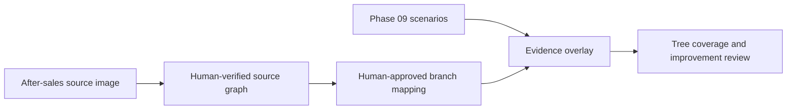

# Phase 09 After-Sales Reference Tree Evidence Overlay

## Purpose

The supplied after-sales decision-tree images are the authoritative diagnostic
knowledge. Phase 09 data supports review and improvement of those trees; it
does not automatically replace a source tree, add a branch, infer a root cause,
or publish a repair action.



## V2 Baseline

The full V12 backup in `C:\Users\q446328\Downloads\defectdecisiontree` was
validated before generating V2:

- 7,094 Phase 09 scenarios
- 14,854 field-scenario Tickets
- 41 V12 Service Function trees
- 39 supplied after-sales reference-tree images

The V2 overlay records its exact input paths in `input_provenance`. This matters
because the V12 copy under `exports/idcevo_phase09` currently contains an
inconsistent reduced snapshot and is rejected by the loader's scenario-count
guard.

## Generated Artifacts

- [exports/idcevo_phase09/IDCEVO_Phase09_AfterSales_Reference_Tree_Evidence_Overlay_V2_FullV12Backup_Catalog.html](../exports/idcevo_phase09/IDCEVO_Phase09_AfterSales_Reference_Tree_Evidence_Overlay_V2_FullV12Backup_Catalog.html)
  - Original after-sales WebP source image is the primary view.
  - Phase 09 problem-type support and high-frequency, unmapped scenario candidates appear beside the image.
- [exports/idcevo_phase09/IDCEVO_Phase09_AfterSales_Reference_Tree_Evidence_Overlay_V2_FullV12Backup.xlsx](../exports/idcevo_phase09/IDCEVO_Phase09_AfterSales_Reference_Tree_Evidence_Overlay_V2_FullV12Backup.xlsx)
  - `01_Reference_Tree_Catalog` tracks source-tree integrity and associated data volume.
  - `02_Phase09_Data_Support` groups historical observations by reference tree and problem type.
  - `03_Unmapped_Scenario_Review` holds scenarios associated at Service Function level but not assigned to a source-tree branch.
  - `04_Uncovered_Service_Gaps` holds scenarios with no matching after-sales source tree.
  - `05_Graph_Structuring_Review` is the queue for source-graph capture and approval.
- [exports/idcevo_phase09/IDCEVO_Phase09_AfterSales_Reference_Tree_Evidence_Overlay_V2_FullV12Backup.json](../exports/idcevo_phase09/IDCEVO_Phase09_AfterSales_Reference_Tree_Evidence_Overlay_V2_FullV12Backup.json)
  - Machine-readable overlay with explicit mapping and input-provenance state.

## Mapping States

| State | Meaning | Permitted use |
| --- | --- | --- |
| `unmapped_pending_branch_verification` | A Scenario belongs to the same Service Function as an original tree, but no human-verified source branch has been selected. | Review candidate only. |
| `no_matching_after_sales_reference_tree` | The Scenario's Service Function has no matching original after-sales tree. | Coverage gap; decide whether to add a tree, add a branch, or approve a specific mapping. |
| `human_approved` | Reserved for a future mapping that cites a branch from a human-verified source graph. | Branch-level evidence support. |

There are 9,168 source-tree/Scenario review candidates in V2 because a Scenario
can be relevant to more than one original reference tree. They represent 7,094
distinct scenarios. There are 2,474 distinct coverage-gap candidates.

Highest uncovered Service Function Ticket volumes in the V2 baseline are HMI
(2,391), Speech (1,103), Audio Media (555), HiCar (421), and Video (404).
These are priorities for after-sales review, not automatic candidates for a
neighboring source tree.

## Source Graph Structure

The previous path-only extraction draft cannot faithfully represent original
source graphs: it lacks directed edges, TRUE/FALSE outcomes, stable source node
IDs, and source-image locations. It is marked deprecated in
[exports/idcevo_phase09/decision_tree_sources/schema_template.json](../exports/idcevo_phase09/decision_tree_sources/schema_template.json).

Use these templates for the next controlled structuring pass:

- [exports/idcevo_phase09/decision_tree_sources/source_graph_template.json](../exports/idcevo_phase09/decision_tree_sources/source_graph_template.json)
  - captures exact source nodes, directed edges, branch outcomes, and pixel bounds.
- [exports/idcevo_phase09/decision_tree_sources/phase09_branch_mapping_template.json](../exports/idcevo_phase09/decision_tree_sources/phase09_branch_mapping_template.json)
  - captures a reviewer-approved link from a Phase 09 Scenario to one verified source node or edge.

Only source graphs with `graph_status: human_verified` may receive branch-level
scenario mappings. Ticket recovery text remains supporting evidence, not a
replacement for an original source-tree action.

## Regeneration

Run the overlay with explicit, validated backup inputs:

```powershell
.venv\Scripts\python.exe backend\analytics\phase09_reference_tree_augmentation.py `
  --scenario-workbook "C:\Users\q446328\Downloads\defectdecisiontree\IDCEVO_Phase09_Field_Escape_Scenario_Library_V12_Symptom_to_Solution_Trees.xlsx" `
  --knowledge-base "C:\Users\q446328\Downloads\defectdecisiontree\IDCEVO_Phase09_Field_Escape_Scenario_Library_V12_Symptom_to_Solution_Trees_Decision_Tree_Knowledge_Base.json" `
  --output-xlsx "exports\idcevo_phase09\IDCEVO_Phase09_AfterSales_Reference_Tree_Evidence_Overlay_V2_FullV12Backup.xlsx" `
  --output-json "exports\idcevo_phase09\IDCEVO_Phase09_AfterSales_Reference_Tree_Evidence_Overlay_V2_FullV12Backup.json" `
  --output-html "exports\idcevo_phase09\IDCEVO_Phase09_AfterSales_Reference_Tree_Evidence_Overlay_V2_FullV12Backup_Catalog.html"
```
