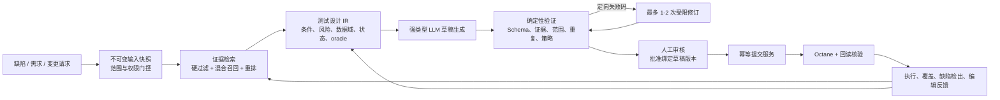

# AI 测试用例生成架构与工程方法调研

## 结论先行

不存在一个客观上“最好的测试用例生成模型”或全自动 Agent。当前最可靠的工程解法是把 LLM 放在一个受控的测试设计编译流水线中：它负责将有证据支撑的结构化测试设计渲染成草稿；确定性代码、执行证据和人工审批决定是否能发布。



对当前 Vizion Lab，建议不是重建一套多 Agent 平台，而是逐步加强现有的 `defect -> RAG -> LLM draft -> verify -> human review -> commit` 链路：

1. 先把每条步骤的事实来源、适用范围和测试设计意图结构化。
2. 再用严格的输出契约和确定性质量门替代正则提取与宽松启发式。
3. 最后用实际执行、缺陷版本复现和人工编辑反馈来衡量有效性，而不是生成数量或 LLM 自评分。

这是固定输入、固定输出和高审计要求的业务流程。预定义 workflow 比开放式自治 Agent 更可预测、可调试，也更符合当前公开的生产实践建议 [5]。

## “好”的定义

测试用例生成要同时满足四个维度；任何一个维度缺失，都不能称为高质量。

| 维度 | 要回答的问题 | 反例 |
| --- | --- | --- |
| 结构合规 | 能否导入、执行和维护？ | JSON/CSV 合法，但没有可操作步骤 |
| 语义正确 | 是否真实理解缺陷、需求和范围？ | 步骤流畅，但引用了错误 ECU、版本或角色 |
| 测试设计充分 | 是否覆盖关键风险、边界、状态和负向路径？ | 只复述缺陷复现，漏掉修复后的回归边界 |
| 测试有效 | 是否能在缺陷版本失败、在修复版本通过，或发现等价故障？ | 覆盖率高、文案漂亮，但断言永远不会失败 |

对于手工 Octane 用例，第四维通常先以“独立执行者能复现、可观察、可判定”衡量；只有接入 SIL/HIL、API sandbox 或 CI 后，才能进一步用缺陷检出率、覆盖增益和 mutation score 验证。

## 推荐的目标架构

### 1. 证据与范围层：让模型不能无依据编造

每次生成应建立一个不可变 `generation_run`，而不是只保存最终 HTML、steps 或 CSV。建议的数据对象如下。

| 对象 | 最少字段 | 作用 |
| --- | --- | --- |
| `source_snapshot` | 来源系统、原始 ID、revision、抓取时间、内容 hash、URL | 固定“当时看到什么” |
| `evidence_claim` | 事实文本、来源片段、支持/反驳极性、适用范围、置信度 | 让每个关键结论可回链 |
| `scope` | 项目、组件、ECU、车型、版本区间、环境、角色、feature flag | 检索前硬过滤，而非事后猜测 |
| `test_condition` | 风险、行为、输入域、状态、触发、observable、oracle | LLM 之前的测试设计中间表示 |
| `draft_revision` | 结构化草稿、schema 版本、内容 hash、validator 结果 | 防止“审批 A、提交 B” |
| `generation_run` | 输入快照、候选集与排除理由、检索/模型/模板/策略版本、成本和时延 | 回放、审计与 A/B 对比 |

这一记录结构可以借鉴 SLSA 的 provenance 思维：记录外部参数、已解析依赖、执行细节和副产物，而不是只记住最终产物 [11]。它不需要照搬 SLSA 协议或引入签名基础设施，但需要满足同一个问题：以后能回答“为什么生成这条测试、依据是什么、由哪个版本的规则生成”。

**范围与证据门槛：**

- `compatible`：项目、版本、组件、环境、角色和配置明确兼容，可以作为高置信证据。
- `incompatible`：任一硬边界冲突，直接从生成上下文排除。
- `unknown`：不可被当作高置信先例；允许进入人工复核候选，但不能支持自动发布。
- 每个关键 `expected_result` 至少引用一项需求/接口契约、修复验证或直接复现证据；历史 testcase 只能作为写法和执行先例，不能单独证明业务真相。

RAG 的价值在于取回可更新的外部事实，不在于将模型预训练知识伪装成证据 [6]。引用质量也是可测属性：ALCE 发现，即便强模型，引用完备性仍存在明显缺口 [9]。所以“有一串链接”不等于“步骤被证据支持”。

### 2. 检索层：先约束，再召回，再做多样化选择

推荐的检索顺序：

1. 解析请求为 `scope + behavior + risk + defect/requirement anchor`。
2. 用 scope 做硬过滤：产品线、ECU、版本、环境、权限、配置和数据分类。
3. 并行召回五类证据：当前需求/契约、缺陷复现与日志、已验证 testcase、领域本体/关系图、相似但被排除的反例。
4. 以 lexical、embedding、ontology、recency、历史执行质量和 scope 冲突做可解释重排。
5. 按测试模式做 MMR/分桶选择，而非把 Top-K 近重复历史案例全部塞进 prompt。

一个可校准的排序形式是：

$$
S = w_s S_{semantic} + w_l S_{lexical} + w_o S_{ontology}
  + w_r S_{recency} + w_q S_{quality} - w_c P_{scope\_conflict}
$$

其中硬 scope 冲突应在计算 $S$ 前直接过滤，不能由很高的语义相似度抵消。对 few-shot，优先选一条直接兼容案例、一条同风险但不同表达的案例，以及一条格式质量高的案例；可选保留一条明确标注“不可模仿”的近邻反例。这样减少陈旧模板和错误模式被放大的风险。

GraphRAG 或知识图谱适合回答跨语料的全局问题，例如“该组件有哪些相邻状态、相关配置与历史缺陷模式”；它不能替代逐步骤的原始证据 [7]。具体步骤仍应依赖可定位的需求、复现证据或已经验证的执行工件。

### 3. 测试设计 IR：先设计，再写句子

这是最值得投入的核心层。LLM 不应直接从缺陷文本跳到自然语言步骤，而应先填充 `TestDesign`：

```text
TestDesign
  scope: project, component, release, environment, role, configuration
  facts: evidence-backed observations and constraints
  risk: impact, likelihood, exposure, safety/compliance tier
  test_conditions:
    - behavior / failure mode
    - preconditions and setup data
    - input partitions and boundaries
    - state transition or rule table, if relevant
    - action / stimulus
    - observable and oracle
    - evidence_refs
  unknowns / assumptions: explicit, never silently invented
```

风险可采用可解释的先验，例如：

$$
R = Impact \times Likelihood \times Exposure \times Change
$$

历史复发率、缺陷簇大小和变更频率可以校准 `Likelihood`，但不能代替业务影响或安全等级。高风险用例不是“写得更长”，而是提升测试设计强度、证据门槛和人工审查等级。

### 4. 测试设计方法路由

最优实践是让缺陷类型路由到适当方法的组合，而不是让 LLM 任意选择措辞。

| 缺陷/需求信号 | 优先方法 | 生成物 | 手工用例价值 | 自动化延展 |
| --- | --- | --- | --- | --- |
| 输入格式、范围、日期、容量、枚举 | 等价类、边界值 | 合法/非法分区、内外边界、oracle | 高 | 参数化/性质测试 |
| 多配置、多车型、多角色、多开关 | 约束感知 $t$-way 组合 | 最小覆盖矩阵和非法组合 | 高 | covering array 驱动的 API/UI 测试 |
| 生命周期、审批、会话、重试、回滚 | 状态转换、MBT | 起始状态、迁移、禁止迁移、恢复路径 | 高 | 路径生成和模型断言 |
| 规则、税费、排序、解析、转换 | 决策表、性质/变形关系 | 输入关系与不变量 | 中 | property/metamorphic tests |
| REST/车云接口 | 契约、状态化 API 测试 | 请求依赖、序列、状态码、重放件 | 中 | RESTler/Schemathesis |
| 时序、并发、资源、诊断 | 事件序列、故障注入、重跑 | 时间边界、竞态场景、trace oracle | 中 | SIL/HIL、fuzz、重复运行 |

NIST 的组合测试研究给出最直接的工业量化证据：在其案例中，相对穷举测试可把测试集缩小约 20 至 700 倍，同时达到相当的故障发现能力 [1]。这不是“pairwise 永远够用”的结论。默认 $t=2$ 适合低到中等风险配置交互；有历史或安全证据表明高阶交互时，应升到 $t=3$ 至 $6$。

对于状态类问题，GraphWalker 清晰地区分边上的动作/迁移和点上的验证/断言 [3]。这种模型在手工 testcase 中也成立：将“起始状态 -> 触发 -> 目标状态/禁止状态 -> 恢复”表达为可审查场景，避免一开始就生成脆弱的 UI 点击脚本。

### 5. 生成和验证层：强类型候选，不是自由文本

建议主输出为版本化的 `TestCaseDraftV1`，至少含：

```json
{
  "title": "...",
  "scope": {"project": "...", "release": "...", "environment": "..."},
  "preconditions": [{"text": "...", "evidenceRefs": ["claim:..."]}],
  "steps": [{
    "sequence": 1,
    "action": "...",
    "expectedResult": "...",
    "observables": ["..."],
    "evidenceRefs": ["claim:..."]
  }],
  "testData": [{"name": "...", "valueOrPartition": "...", "evidenceRefs": ["claim:..."]}],
  "riskTags": ["..."],
  "assumptions": [],
  "unknowns": []
}
```

实现优先级：

1. 使用模型供应商的 strict structured output 或受约束 JSON Schema；Node 和 Python 共用同一 schema 或用契约测试验证两端模型一致。
2. 将 regex JSON 提取和修复降为兼容性 fallback，解析失败不允许进入提交链路。
3. 先跑确定性验证器，再让 LLM judge 只处理灰区；结构正确不表示语义真实。
4. 定向修订最多 $1$ 到 $2$ 次。修订器只接收机器可读失败码和允许修改的字段；预算耗尽则转人工，而不是无限循环。

建议的验证门按成本从低到高依次执行：

| 门 | 典型规则 | 不通过后的动作 |
| --- | --- | --- |
| 输入 | anchor、scope、最低复现证据、ACL | 请求补证或生成受限草稿 |
| Schema | 类型、枚举、长度、步骤数量、禁止多余字段 | 自动阻断 |
| 业务完整性 | 前置条件、刺激、可观察 expected result、清理动作 | 定向修订 |
| 证据 | 关键断言有证据，引用真实蕴含该断言 | 定向修订或人工 |
| 范围 | 版本/角色/配置与请求一致 | 自动阻断或人工 |
| 重复/冲突 | 已有关联 testcase、近重复步骤、冲突事实 | 建议关联/更新，而非新建 |
| 风险 | 高风险 must-cover、敏感数据、注入信号 | 强制人工复核 |
| 有效性 | 缺陷版本失败、修复版本通过、稳定性、覆盖/变异 | 发布后/回归阶段反馈 |

LLM-as-judge 可作为基于 rubric 的预筛和排序器，不能担任最终事实裁判。必须用独立人工金标校准其对关键遗漏、臆造和不可执行步骤的 precision、recall 与按严重度分层漏判率。

### 6. 人工审批、提交与安全：把不可逆动作放在确定性服务

状态建议为：

```text
RECEIVED -> GENERATED -> STRUCTURALLY_VALIDATED -> QUALITY_GATED
-> PENDING_REVIEW -> APPROVED -> COMMITTING -> COMMITTED
```

另有 `NEEDS_REVISION`、`REJECTED`、`FAILED_RETRYABLE`、`FAILED_TERMINAL` 和 `CONFLICT`。所有状态转移应记录 actor、原因码、时间、输入/输出 hash 与 policy version。

- 生成服务默认无 Octane 写凭据，只读受限工具。
- 验证服务无外部写权限。
- 提交服务最小权限，仅能在授权 workspace/project 创建允许的 `test_manual` 字段；以 `source_defect_id + template_version + approved_draft_hash` 形成稳定幂等键。
- 审批应绑定精确 `draft_id + revision + content_hash`。提交前再次比较，防止草稿漂移。
- Octane 超时是“结果未知”而不是“写入失败”：先以幂等键或外部引用回查，再决定是否重试。
- 每项目和每 workspace 还应有调用并发、总 token、重试次数、墙钟时长和日成本上限。

检索到的缺陷描述、评论、附件、网页和日志都应被标记为不可信数据，而不是可执行指令。OWASP 把 indirect prompt injection 明确列为来自外部文件/网页的风险，并建议严格输出校验、最小权限、人审和对抗测试 [12]。

## 现有 Vizion Lab 的差距映射

| 能力 | 当前已具备 | 下一步差距 |
| --- | --- | --- |
| 缺陷模式发现 | `testcase_pattern_discovery.py` 已要求复现证据、按项目/ECU/车型分桶、对未知上下文提高门槛并要求人工审核 | 将同样的 evidence/scope 纪律前移到单条 `prepare` 与每个步骤 |
| 本体与上下文 | ontology context 已规定 testcase drafting 需调用 `get_test_case_context` | 直接创建流程返回的 `defect_info` 仍主要是单行 defect 字段和相似 testcase；需要携带版本、环境、角色、来源片段、冲突与兼容结论 |
| RAG 与 few-shot | 已检索相似 Octane testcase 并生成 few-shot | 从 Top-K 相似度升级为范围过滤、混合检索、质量/新鲜度重排和多样化示例选择 |
| 生成 | 已将 Node LLM 调用与 Python bridge 分层，支持 batch 并发和模式草稿 | `server/index.mjs` 仍以正则提取/修复 JSON；需要强类型 schema 和字段级 evidence refs |
| 验证 | `test_case_verifier.py` 已有格式、标题词重合、动作数、量化 checkpoint、defect ID 等确定性检查 | 当前是 5 项启发式，不验证事实蕴含、scope、预期结果可观测性、负向/边界覆盖、重复和安全策略 |
| 审核与输出 | 草稿与明确 commit 已分离，支持 CSV 离线审核 | 需要 draft revision、审批 hash、generation run、幂等提交与回读核验 |
| 评估 | 已有 verifier、人工编辑面和 CSV 工件可作为信号 | 尚需时间隔离基准、人工 rubric、缺陷检出真值、模型/提示词版本级实验归因 |

结论：现有代码的方向正确，尤其是“模式先证据门控、生成后人工审核、写入单独动作”。最大的增量不在另接一个更强的 Agent，而在把这套纪律统一成一个版本化的测试设计与发布控制平面。

## 从手工测试到可执行测试的分阶段演进

### 阶段 A：立即可做的手工 testcase 契约化

每条手工 testcase 除 Octane 富文本外保存：`preconditions`、`stimulus`、`observable`、`oracle`、`cleanup`、`risk tier`、`evidence schema`、`replay artifact` 和 `environment fingerprint`。

禁止“功能正常”“检查是否正确”这类不可判定预期。应改成可观察条件，例如“在 $t \le 200\,ms$ 内，信号 `X` 从 0 变为 1，且无 DTC `Pxxxx`”。这会直接提升人工执行的一致性，也为后续自动化准备输入。

### 阶段 B：受控回放与执行证据

- API：关联 OpenAPI operation、认证模式、请求序列、cURL/Postman/HAR、测试数据与响应断言。
- ECU/诊断：关联 CAN/UDS 序列、DBC/ARXML 版本、SIL/HIL 台架配置、时钟基准、trace hash 和清理动作。
- 每次执行保存 software build、标定/HW、环境、seed、执行人、原始日志/截图/trace、verdict。
- 失败先分为环境、测试设计、实现回归、预期变更；不要让模型把失败用例直接改写成“通过”。

### 阶段 C：对可自动化目标引入执行反馈

CoverUp 的论文结果说明，较好的生成表现来自“覆盖分析 + 代码上下文 + 执行反馈”的组合，而不是单靠 LLM。其 Python 原型报告的 per-module median line+branch coverage 是 80%，相对 CodaMosa 的 47%；这只能作为可执行 Python 测试的研究证据，不能外推成手工 testcase 的质量指标 [10]。

- 对 Python 服务：试点 `pytest + coverage`，再挑选适合的模块探索 CoverUp/Pynguin。
- 对 Java/JVM：EvoSuite 用于搜索式生成基线，PIT 用于 mutation effectiveness。
- 对 OpenAPI：RESTler 可从 API 规格推断 producer-consumer 依赖，探索状态化请求序列，并输出 replay log [8]；Schemathesis 可作为属性/契约测试补充。
- 对 C/C++ ECU 逻辑：先选 SIL 内可运行的 parser、协议解码、诊断逻辑，再用 Sanitizer、libFuzzer/AFL++/Centipede；不要对实车、生产后端或开放车辆网络执行无约束 fuzz。

PIT 对 mutation 的解释很直接：传统 line/branch coverage 只证明代码被执行，mutation testing 检查测试是否能使故意修改后的程序失败 [4]。Mutation score 应用于可以自动执行的范围，不能为了报表把它伪装成纯手工 testcase 的指标。

## 评估与持续学习

### 冻结、时间隔离的基准集

建立约 100 至 200 个“defect package”作为首轮评估集。每个 package 应含当时可见的缺陷初始描述、环境、附件、需求和日志；修复提交、最终 testcase 和执行结果只作为隐藏真值。按时间切分且按功能簇/重复缺陷族做 group split，避免同根因案例同时出现在调优与测试集。

不要按 CSV 行随机切分。最常见的数据泄漏来自：RAG 索引包含未来修复信息、关闭评论、最终 testcase、同簇重开单，或者人员用冻结测试集持续调 prompt。

### 质量指标

**结构与语义：**

- `traceability completeness`：关键步骤/预期有有效证据引用的比例。
- `must-cover recall`：金标关键风险、状态、边界和负向条件被覆盖的比例。
- `unsupported-claim rate`：无证据的系统/业务声明比例。
- `executable-case rate`：独立测试员可执行且可判定结果的比例。
- `critical-risk miss rate`：关键风险漏测比例，应作为发布红线而非平均分的一部分。

**有效性：**

$$
\text{Defect Detection Rate} =
\frac{\text{在缺陷版本失败且在修复版本通过的目标用例数}}
{\text{具备可执行环境的目标缺陷数}}
$$

配合缺陷版本复现率、修复版本通过率、mutation score、flaky rate、回放成功率和按严重度加权的缺陷检出收益。

**人工与运营：**

- 无实质编辑即接受的比例，以及按字段/步骤的编辑负担。
- 拒绝原因：臆造、前置条件缺失、预期模糊、范围错误、漏边界、合规问题。
- 每条被采纳用例的人工分钟数、每条有效缺陷的成本、p50/p95 时延、token/call/retry 消耗。
- 模型、prompt、schema、检索、validator 和 policy 的版本效应。

人工 rubric 采用原子化 0/1/2 标签，而非单一“好/坏”分：缺陷理解、前置条件、可操作性、oracle、正/负/边界覆盖、证据、臆造和安全/合规。关键样本双盲双标，二元标签报告 Cohen's $\kappa$，多评审报告 Krippendorff's $\alpha$；一致性低时先修改 rubric 与示例，而不是用噪声标签优化模型。

### 发布与学习策略

1. 离线冻结集比较候选模型、检索、模板和 verifier；关键风险漏测率不得劣于基线。
2. 影子运行：AI 生成草稿但不进入正式交付，记录人工从零编写与审核 AI 草稿的差异。
3. 对低风险、成熟模块做分层 A/B 或 stepped-wedge 试验；高严重度始终保留人工批准。
4. 将编辑分类、执行失败和逃逸缺陷回写为结构化反馈，用于改进检索、路由、模板和规则，而不是直接把原始文本不加筛选地拿去训练。
5. 每月校准 judge 与人工差异；每季度只向基准补充时间上晚于冻结集的新数据，原基准不回写。

## 90 天落地优先级

| 时间 | 目标 | 最小交付物 | 成功判据 |
| --- | --- | --- | --- |
| 0-2 周 | 建立生成控制平面 | `TestCaseDraftV1` schema、run/draft revision 数据模型、输入/输出 hash、确定性 schema 验证 | 无未验证草稿可提交；可回放每次生成 |
| 3-6 周 | 将测试设计与证据前移 | `TestDesign` IR、scope/evidence gate、步骤级 evidence ref、路由模板、结构化退回原因 | 关键步骤可追溯率上升；范围错误和人工大改下降 |
| 7-10 周 | 构建可信评估 | 时间隔离 defect package、rubric v1、100-200 条盲评基线、版本门禁 | 能量化 must-cover、臆造和编辑负担，不再只看 verifier pass |
| 11-12 周 | 执行闭环试点 | 一个低风险 API 或 SIL 目标的 replay/execution 接入 | 可报告 defect-version/fix-version 结果，或稳定的执行证据 |

**暂不建议优先做的事：**

- 不先做自治多 Agent、动态工具链或无审批的 Octane 自动写入。
- 不先做大量 prompt 微调或 fine-tuning；如果证据、范围、设计 IR 和金标都不稳定，训练只会固化错误。
- 不将“生成了多少 testcase”“CSV 成功导出”或“LLM judge 高分”作为业务成功指标。
- 不把 GraphRAG、browser computer-use 或 Temporal 当作质量本身；它们分别解决全局知识、浏览器执行和长事务可靠性，只应在核心闭环稳定后按问题引入。

## 候选方法与工具的定位

| 方法/项目 | 成熟度与证据 | 最适合解决的问题 | 对 Vizion Lab 的建议 |
| --- | --- | --- | --- |
| NIST ACTS / $t$-way | 成熟、工业案例 | 配置/角色/车型/版本交互 | P1：用于生成可审查最小组合矩阵 |
| 状态模型、GraphWalker、Hypothesis stateful | 成熟方法，工具可用 | 生命周期、权限、重试、恢复 | P1：先为手工场景建模，稳定后再接自动化 |
| TestGen-LLM 的过滤模式 | 有工业部署论文 | 生成后以可构建、稳定、覆盖增益筛选 | P0/P2：吸收“候选必须通过硬过滤”的方法，不直接照搬数字 |
| CoverUp | Python 研究/开源 | 覆盖反馈驱动的单元测试生成 | P2：只在隔离的可执行 Python 目标试点 |
| RESTler / Schemathesis | 成熟开源 | OpenAPI 的状态、契约、负向与回放 | P2：测试环境/车云 API，不对生产运行 |
| PIT / mutation testing | 成熟 JVM 工具 | 断言强度和回归有效性 | P2：增量运行于变更模块 |
| Playwright MCP | 活跃开源 | Web 测试环境探索、trace 与 UI 证据 | P3：隔离账号和允许域内，作为执行证据层 |
| BrowserGym/WorkArena | 研究评测基础设施 | 企业 Web Agent 轨迹与任务评测 | P3：借鉴 sandbox、fixture、oracle，不直接当产品 |
| SWE-agent / mini-SWE-agent | 活跃开源 | 仓库级影响分析、测试维护 | P3：只读 workspace + 临时工作树，禁止直写 Octane |
| Daikon | 成熟研究工具 | 从执行轨迹挖掘可能不变量 | P3：专家筛选后转为 property/oracle 候选 |

## 风险与反论

- **组合覆盖不是业务覆盖。** 它会遗漏未建模需求、错误 oracle、复杂时序和高阶交互；风险决定 $t$ 值，不能把 pairwise 当作完整性证明。
- **MBT 的成本在模型维护。** 模型一旦歧义，难区分模型错、需求错还是实现错；先选稳定、状态复杂、价值高的少数域试点。
- **历史 testcase 不一定正确。** 相似检索可能把陈旧写法、被动修补或误判预期复制到新用例；质量、新鲜度、范围和执行结果必须参与排序。
- **LLM judge 有偏差。** 同源模型可能偏好自己的文风、长答案或位置固定的候选；只用于辅助筛查，关键结论由证据、规则和人审决定。
- **自动化指标不等于安全合规。** ISO 26262 等安全生命周期要求可追溯、独立审查和可复现证据；对于 ASIL/法规相关软件，LLM 输出只能是候选工作产品。
- **RAG 也是攻击面。** 缺陷评论、附件和网页可能带注入指令；内容可信度和 API 权限必须在模型外部强制执行。

## 来源与可信度说明

以下来源以标准/政府研究、同行评审论文、官方项目文档、供应商工程文章为主。供应商材料用于架构模式，不作为该供应商产品效果的独立证明；论文结果只适用于其任务、数据集和实验环境。

1. [NIST, Automated Combinatorial Testing for Software / ACTS](https://csrc.nist.gov/projects/automated-combinatorial-testing-for-software)
2. [NIST SP 800-142, Practical Combinatorial Testing](https://csrc.nist.gov/pubs/sp/800/142/final)
3. [GraphWalker official documentation](https://graphwalker.github.io/)
4. [PIT mutation testing official documentation](https://pitest.org/)
5. [Anthropic, Building effective agents](https://www.anthropic.com/engineering/building-effective-agents)
6. [Lewis et al., Retrieval-Augmented Generation for Knowledge-Intensive NLP Tasks](https://arxiv.org/abs/2005.11401)
7. [Edge et al., From Local to Global: A Graph RAG Approach to Query-Focused Summarization](https://arxiv.org/abs/2404.16130)
8. [Microsoft RESTler](https://github.com/microsoft/restler-fuzzer)
9. [Gao et al., Enabling Large Language Models to Generate Text with Citations / ALCE](https://arxiv.org/abs/2305.14627)
10. [Pizzorno and Berger, CoverUp: Effective High Coverage Test Generation for Python](https://arxiv.org/abs/2403.16218)
11. [SLSA v1.2, Provenance](https://slsa.dev/spec/v1.2/provenance)
12. [OWASP LLM01:2025 Prompt Injection](https://genai.owasp.org/llmrisk/llm01-prompt-injection/)
13. [NIST AI Risk Management Framework](https://www.nist.gov/itl/ai-risk-management-framework)
14. [ISO/IEC/IEEE 29119-1:2022, Software testing - General concepts](https://www.iso.org/standard/81291.html)
15. [ISTQB CTFL v4.0, test analysis/design and risk management coverage](https://www.istqb.org/certifications/certified-tester-foundation-level)
16. [Alshahwan et al., Automated Unit Test Improvement using Large Language Models at Meta / TestGen-LLM](https://arxiv.org/abs/2402.09171)
17. [Hypothesis stateful testing documentation](https://hypothesis.readthedocs.io/en/latest/stateful.html)
18. [Asai et al., Self-RAG](https://arxiv.org/abs/2310.11511)
19. [Yan et al., Corrective Retrieval Augmented Generation](https://arxiv.org/abs/2401.15884)
20. [Zhang et al., RAFT: Adapting Language Model to Domain Specific RAG](https://arxiv.org/abs/2403.10131)
21. [Liu et al., Lost in the Middle: How Language Models Use Long Contexts](https://arxiv.org/abs/2307.03172)
22. [Jimenez et al., SWE-bench](https://arxiv.org/abs/2310.06770)
23. [NIST AI 600-1, Generative AI Profile](https://doi.org/10.6028/NIST.AI.600-1)
24. [Microsoft Playwright MCP](https://github.com/microsoft/playwright-mcp)
25. [ServiceNow BrowserGym](https://github.com/ServiceNow/BrowserGym)
26. [Daikon dynamic invariant detection](https://plse.cs.washington.edu/daikon/)
